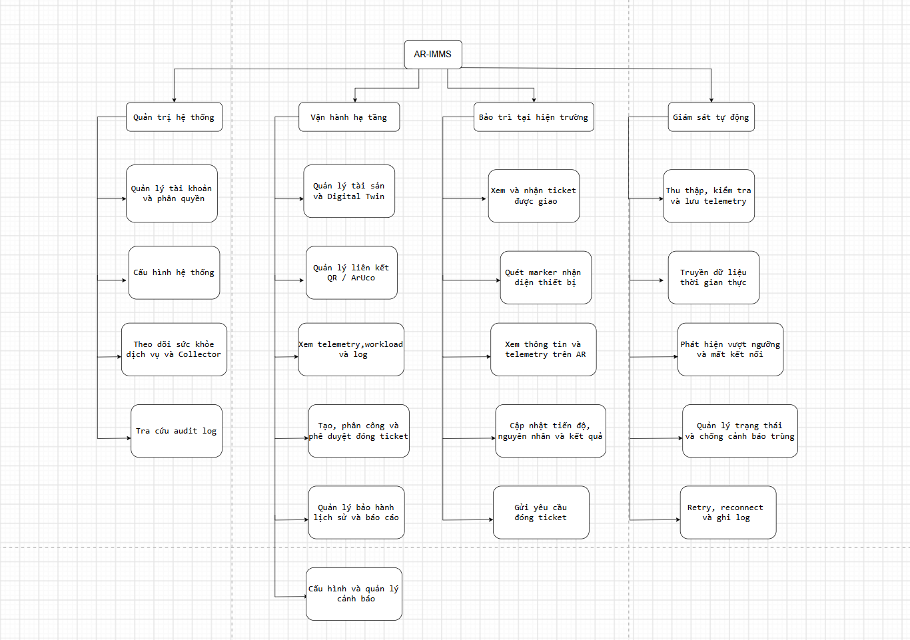

# Yêu cầu chức năng hệ thống AR-IMMS
## 1. Mục đích

Mô tả các chức năng hệ thống cần cung cấp để hỗ trợ
quản trị, giám sát và bảo trì hạ tầng trong Mini Data Center Testbed.

Tài liệu mô tả yêu cầu, không khẳng định mọi chức năng
đã được triển khai.

## 2. Tác nhân

| Tác nhân | Vai trò |
|---|---|
| Administrator | Quản trị tài khoản, quyền truy cập và cấu hình hệ thống |
| Operator | Quản lý tài sản, giám sát và điều phối xử lý sự cố |
| Technician | Kiểm tra thiết bị và thực hiện bảo trì được giao |
| Collector Agent | Thu thập và gửi dữ liệu vận hành |

## 3. Danh sách yêu cầu

### FR-01 — Đăng nhập và xác thực

**Tác nhân:** Administrator, Operator, Technician.

**Yêu cầu:**

- Cho phép đăng nhập bằng email và mật khẩu.
- Xác minh thông tin tài khoản và trạng thái hoạt động.
- Cấp JWT khi đăng nhập thành công.
- Bảo vệ các API yêu cầu đăng nhập.
- Cho phép đăng xuất bằng cách xóa thông tin phiên trên ứng dụng.

**Tiêu chí chấp nhận:**

- Tài khoản hợp lệ đăng nhập thành công.
- Sai thông tin đăng nhập trả về 401.
- API được bảo vệ từ chối JWT thiếu, sai hoặc hết hạn.

### FR-02 — Quản lý tài khoản và quyền truy cập

**Tác nhân:** Administrator.

**Yêu cầu:**

- Xem danh sách tài khoản.
- Tạo tài khoản và gán vai trò hợp lệ.
- Cập nhật quyền và trạng thái hoạt động theo chính sách.
- Hỗ trợ đặt lại mật khẩu theo quyền được cấp.
- Kiểm tra quyền tại Backend cho từng thao tác.

**Tiêu chí chấp nhận:**

- Operator và Technician không được truy cập API quản trị tài khoản.
- Tài khoản bị vô hiệu hóa không được truy cập API được bảo vệ.
- API không trả về mật khẩu hoặc password hash.

### FR-03 — Quản lý tài sản hạ tầng

**Tác nhân:** Administrator, Operator.

**Yêu cầu:**

- Quản lý Site, Room, Rack, Node và Workload.
- Liên kết tài sản theo cấu trúc:
  Site → Room → Rack → Node → Workload.
- Kiểm tra mã định danh, khóa ngoại và ràng buộc dữ liệu.
- Áp dụng quyền tạo, cập nhật và xóa theo ma trận phân quyền.

**Tiêu chí chấp nhận:**

- Không tạo hoặc cập nhật tài sản với tham chiếu cha không hợp lệ.
- Không chấp nhận mã trùng trong phạm vi duy nhất đã quy định.
- Thao tác xóa tuân thủ ràng buộc quan hệ và quy tắc nghiệp vụ.

### FR-04 — Tra cứu cấu trúc và thông tin tài sản

**Tác nhân:** Administrator, Operator, Technician.

**Yêu cầu:**

- Xem danh sách và chi tiết tài sản theo quyền được cấp.
- Hiển thị vị trí và quan hệ của tài sản trong cấu trúc hạ tầng.
- Cung cấp thông tin định danh phục vụ giám sát và bảo trì.

**Tiêu chí chấp nhận:**

- Hiển thị đúng thông tin và quan hệ đã lưu.
- Tài sản không tồn tại trả về thông báo phù hợp.
- Không cung cấp dữ liệu ngoài phạm vi truy cập được cấp.

### FR-05 — Tra cứu thiết bị bằng marker và Mobile AR

**Tác nhân:** Technician.

**Yêu cầu:**

- Nhận diện marker bằng camera trên ứng dụng Mobile AR.
- Ánh xạ marker tới tài sản đã đăng ký.
- Hiển thị thông tin thiết bị và dữ liệu phục vụ kiểm tra.
- Thông báo khi không nhận diện được hoặc marker chưa liên kết.

**Tiêu chí chấp nhận:**

- Marker hợp lệ dẫn đến đúng tài sản.
- Không hiển thị nhầm thông tin khi marker không hợp lệ.
- Thông tin AR phản ánh dữ liệu và quyền truy cập từ Backend.

### FR-06 — Thu thập dữ liệu telemetry

**Tác nhân:** Collector Agent.

**Yêu cầu:**

- Thu thập các chỉ số được hỗ trợ trong testbed.
- Gửi dữ liệu kèm định danh nguồn và thời điểm ghi nhận.
- Backend xác thực nguồn gửi và kiểm tra dữ liệu trước khi lưu.
- Chu kỳ thu thập và gửi dữ liệu tuân theo cấu hình đã thống nhất.

**Tiêu chí chấp nhận:**

- Dữ liệu hợp lệ được gắn đúng Node hoặc Workload.
- Dữ liệu sai định dạng được xử lý theo quy tắc kiểm tra dữ liệu.
- Không chấp nhận dữ liệu từ nguồn không được phép.

### FR-07 — Hiển thị trạng thái hạ tầng

**Tác nhân:** Operator; Administrator và Technician theo quyền được cấp.

**Yêu cầu:**

- Hiển thị trạng thái tài sản và trạng thái kết nối.
- Thể hiện thời điểm cập nhật cuối.
- Phân biệt dữ liệu còn hiệu lực, dữ liệu cũ và mất kết nối.

**Tiêu chí chấp nhận:**

- Không hiển thị dữ liệu cũ như trạng thái hiện tại mà không có chỉ dẫn.
- Trạng thái kết nối được xác định theo quy tắc đã cấu hình.

### FR-08 — Cập nhật telemetry trên giao diện

**Tác nhân:** Operator; Administrator và Technician theo quyền được cấp.

**Yêu cầu:**

- Cập nhật giao diện khi Backend nhận và xử lý dữ liệu mới.
- Hiển thị chỉ số, đơn vị và thời điểm dữ liệu.
- Thông báo khi kênh cập nhật bị gián đoạn.
- Đồng bộ lại dữ liệu sau khi kết nối phục hồi.

**Tiêu chí chấp nhận:**

- Giao diện thể hiện dữ liệu mới theo chu kỳ và độ trễ đã thống nhất.
- Người sử dụng nhận biết được dữ liệu chưa được cập nhật.

**Ghi chú:**

Cơ chế cập nhật giao diện không thay thế chu kỳ thu thập của Agent.
Các giá trị thời gian được quy định trong tài liệu yêu cầu phi chức năng.

### FR-09 — Phát hiện và quản lý cảnh báo

**Tác nhân:** Operator.

**Yêu cầu:**

- Cấu hình điều kiện cảnh báo theo phạm vi được cấp.
- Đánh giá telemetry hoặc trạng thái kết nối theo điều kiện.
- Tạo và hiển thị cảnh báo gắn với tài sản.
- Theo dõi trạng thái cảnh báo.
- Hạn chế cảnh báo trùng theo quy tắc đã thống nhất.

**Tiêu chí chấp nhận:**

- Điều kiện được thỏa mãn tạo cảnh báo phù hợp.
- Cảnh báo có thông tin tài sản, thời điểm và nguyên nhân.
- Việc tạo lại hoặc kết thúc cảnh báo tuân theo vòng đời đã quy định.

### FR-10 — Tạo và phân công ticket

**Tác nhân:** Operator.

**Yêu cầu:**

- Tạo ticket xử lý sự cố hoặc bảo trì.
- Liên kết ticket với tài sản và cảnh báo khi phù hợp.
- Phân công Technician phụ trách.
- Theo dõi người phụ trách và trạng thái công việc.

**Tiêu chí chấp nhận:**

- Ticket có đủ thông tin bắt buộc.
- Chỉ phân công cho tài khoản phù hợp và đang hoạt động.
- Technician xem được công việc được giao.

### FR-11 — Theo dõi xử lý sự cố và bảo trì

**Tác nhân:** Operator, Technician.

**Yêu cầu:**

- Technician cập nhật tiến độ và kết quả công việc được giao.
- Ghi nhận nội dung kiểm tra, xử lý và bằng chứng theo thiết kế.
- Operator kiểm tra kết quả và phê duyệt đóng ticket.
- Lưu lịch sử thay đổi và bảo trì liên quan.

**Tiêu chí chấp nhận:**

- Không cho phép cập nhật công việc ngoài phạm vi được cấp.
- Chuyển trạng thái tuân theo vòng đời ticket.
- Technician không tự thực hiện bước phê duyệt đóng ticket của Operator.

### FR-12 — Tra cứu telemetry lịch sử

**Tác nhân:** Operator; các vai trò khác theo quyền được cấp.

**Yêu cầu:**

- Tra cứu telemetry theo tài sản và khoảng thời gian.
- Hiển thị đơn vị và thời điểm ghi nhận.
- Thông báo khi khoảng thời gian được chọn không có dữ liệu.

**Tiêu chí chấp nhận:**

- Kết quả thuộc đúng tài sản và khoảng thời gian yêu cầu.
- Không coi dữ liệu bị thiếu là giá trị đo bằng không.

### FR-13 — Quản lý cấu hình giám sát

**Tác nhân:** Administrator, Operator theo phạm vi được cấp.

**Yêu cầu:**

- Quản lý các tham số giám sát được hệ thống hỗ trợ.
- Kiểm tra tính hợp lệ trước khi áp dụng cấu hình.
- Thể hiện rõ cấu hình đang có hiệu lực.
- Phân biệt cấu hình đã lưu và cấu hình đã được Agent áp dụng
  nếu có cơ chế phân phối cấu hình.

**Tiêu chí chấp nhận:**

- Từ chối cấu hình không hợp lệ hoặc thao tác không đủ quyền.
- Việc thay đổi cấu hình có thể truy vết theo chính sách audit.

### FR-14 — Ghi nhật ký thao tác và kiểm toán

**Tác nhân:** Administrator; hệ thống tự động ghi nhận.

**Yêu cầu:**

- Ghi nhận các thao tác thuộc phạm vi audit.
- Lưu người thực hiện, hành động, đối tượng, thời điểm và kết quả.
- Cho phép người được cấp quyền tra cứu nhật ký.
- Không ghi mật khẩu, JWT hoặc thông tin bí mật vào nhật ký.

**Tiêu chí chấp nhận:**

- Thao tác thuộc phạm vi audit có bản ghi tương ứng.
- Người không đủ quyền không được xem hoặc sửa nhật ký.
- Nhật ký được bảo vệ theo chính sách toàn vẹn dữ liệu.

### FR-15 — Xử lý lỗi truyền và chất lượng telemetry

**Tác nhân:** Collector Agent; hệ thống tự động xử lý.

**Yêu cầu:**

- Phát hiện và xử lý lỗi gửi hoặc nhận telemetry.
- Thực hiện retry theo chính sách được cấu hình.
- Kiểm tra định dạng, nguồn gửi và thời điểm dữ liệu.
- Xử lý mẫu trùng và dữ liệu đến muộn theo quy tắc đã thống nhất.
- Thể hiện tình trạng gián đoạn hoặc thiếu dữ liệu trên giao diện.

**Tiêu chí chấp nhận:**

- Lỗi truyền không làm hệ thống ngừng phục vụ các chức năng khác.
- Retry không tạo dữ liệu trùng ngoài chính sách cho phép.
- Không ghi nhận dữ liệu giả định như dữ liệu đo thực tế.

## 4. Quan hệ với tài liệu khác

- Quyền chi tiết được quy định trong tài liệu phân quyền.
- Chu kỳ telemetry, timeout, retry và độ trễ
  được quy định trong yêu cầu phi chức năng.
- Quan hệ và ràng buộc lưu trữ được mô tả trong ERD.
- Luồng thao tác chi tiết được mô tả trong Use Case.
- Trạng thái hoàn thành được ghi trong tài liệu sprint và kiểm thử.

## 5. Quản lý thay đổi

Giữ ổn định các mã FR để liên kết với Use Case,
task Jira và ca kiểm thử.

Khi thay đổi yêu cầu, cần cập nhật các tài liệu liên quan
và ghi nhận quyết định của nhóm.
