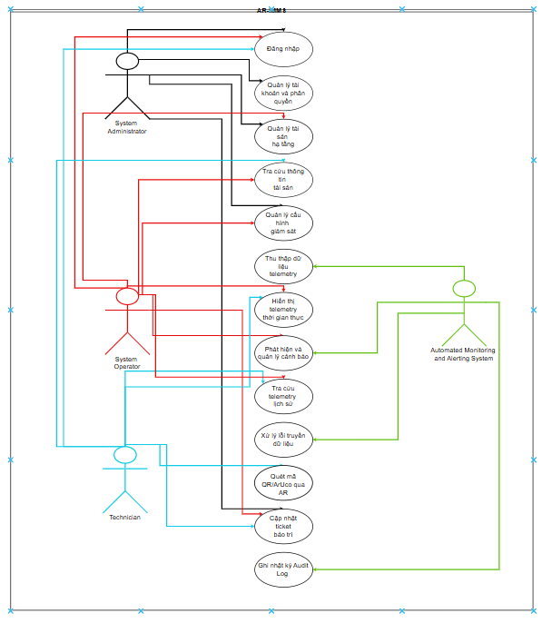

# Use Case hệ thống AR-IMMS

## 1. Mục đích

Mô tả các luồng tương tác chính giữa tác nhân và hệ thống,
làm cơ sở thiết kế giao diện, API và ca kiểm thử.

Tài liệu mô tả yêu cầu nghiệp vụ.
Trạng thái triển khai được theo dõi trong tài liệu sprint.

## 2. Tác nhân

- Administrator: quản trị tài khoản và hệ thống.
- Operator: quản lý tài sản, giám sát và điều phối công việc.
- Technician: kiểm tra thiết bị và thực hiện bảo trì.
- Collector Agent: thu thập và gửi dữ liệu vận hành.

## 3. Danh sách Use Case

| Mã | Use Case | Tác nhân chính | Yêu cầu liên quan |
|---|---|---|---|
| UC-01 | Đăng nhập và truy cập Portal | Người sử dụng | FR-01 |
| UC-02 | Quản lý tài khoản | Administrator | FR-02 |
| UC-03 | Quản lý tài sản | Administrator, Operator | FR-03, FR-04 |
| UC-04 | Thu thập và tiếp nhận telemetry | Collector Agent | FR-06, FR-15 |
| UC-05 | Giám sát và tra cứu telemetry | Operator | FR-07, FR-08, FR-12 |
| UC-06 | Phát hiện và xử lý cảnh báo | Operator | FR-09, FR-13 |
| UC-07 | Tạo và phân công ticket | Operator | FR-10 |
| UC-08 | Kiểm tra thiết bị bằng Mobile AR | Technician | FR-04, FR-05 |
| UC-09 | Cập nhật kết quả bảo trì | Technician | FR-11 |
| UC-10 | Phê duyệt đóng ticket | Operator | FR-11 |
| UC-11 | Tra cứu audit log | Administrator | FR-14 |
| UC-12 | Quản lý cấu hình giám sát | Administrator, Operator | FR-13 |
| UC-13 | Xử lý lỗi truyền và kiểm soát chất lượng telemetry | Collector Agent | FR-15 |
Các tác nhân khác chỉ tham gia khi được cấp quyền
theo ma trận phân quyền.

## 4. UC-01 — Đăng nhập và truy cập Portal

**Tác nhân:** Administrator, Operator, Technician.

**Tiền điều kiện:**

- Tài khoản đã tồn tại và đang hoạt động.
- Ứng dụng kết nối được Backend.

**Luồng chính:**

1. Người sử dụng mở trang đăng nhập.
2. Nhập email và mật khẩu.
3. Hệ thống kiểm tra thông tin đăng nhập.
4. Backend cấp JWT nếu thông tin hợp lệ.
5. Ứng dụng xác minh thông tin tài khoản qua Backend.
6. Hệ thống hiển thị Portal và menu phù hợp với vai trò.

**Luồng thay thế:**

- Sai thông tin đăng nhập: thông báo lỗi, không cấp JWT.
- Mất kết nối: thông báo lỗi và cho phép thử lại.
- Phiên hết hạn hoặc không hợp lệ: yêu cầu đăng nhập lại.
- Không đủ quyền truy cập trang: hiển thị thông báo không có quyền.

**Hậu điều kiện:**

Người sử dụng truy cập được các chức năng được cấp quyền.

**Đăng xuất:**

Ứng dụng xóa thông tin phiên tại trình duyệt
và chuyển về trang đăng nhập.

## 5. UC-02 — Quản lý tài khoản

**Tác nhân:** Administrator.

**Tiền điều kiện:**

Administrator đã đăng nhập và có quyền quản trị tài khoản.

**Luồng chính:**

1. Administrator mở chức năng Quản lý tài khoản.
2. Hệ thống hiển thị danh sách tài khoản.
3. Administrator chọn thao tác tạo hoặc cập nhật.
4. Nhập thông tin và vai trò theo phạm vi được phép.
5. Hệ thống kiểm tra dữ liệu và quyền thao tác.
6. Hệ thống lưu thay đổi và trả kết quả.

**Luồng thay thế:**

- Email trùng: từ chối tạo tài khoản.
- Dữ liệu không hợp lệ: thông báo trường cần sửa.
- Không đủ quyền: từ chối thao tác.
- Tài khoản không tồn tại: thông báo không tìm thấy.

**Hậu điều kiện:**

Thông tin tài khoản được cập nhật.
Mật khẩu và password hash không được trả về trong dữ liệu tài khoản.

## 6. UC-03 — Quản lý tài sản

**Tác nhân:** Administrator, Operator.

**Tiền điều kiện:**

Người sử dụng đã đăng nhập và được cấp quyền thao tác.

**Luồng chính:**

1. Mở chức năng Tài sản.
2. Chọn loại tài sản cần quản lý.
3. Xem danh sách hoặc chi tiết.
4. Chọn tạo hoặc cập nhật tài sản.
5. Nhập thông tin và liên kết tài sản cha.
6. Hệ thống kiểm tra dữ liệu, mã định danh và quan hệ.
7. Hệ thống lưu thay đổi và trả kết quả.

**Luồng xóa:**

1. Administrator chọn tài sản cần xóa.
2. Hệ thống kiểm tra quyền và ràng buộc liên quan.
3. Nếu hợp lệ, thực hiện xóa và trả kết quả.

**Luồng thay thế:**

- Mã trùng trong phạm vi quy định: từ chối thao tác.
- Tài sản cha không tồn tại: từ chối tạo hoặc cập nhật.
- Tài sản còn dữ liệu phụ thuộc: từ chối xóa theo ràng buộc.
- Operator hoặc Technician yêu cầu xóa trái quyền: trả về 403.

**Hậu điều kiện:**

Dữ liệu tài sản bảo đảm quan hệ và ràng buộc đã thiết kế.

## 7. UC-04 — Thu thập và tiếp nhận telemetry

**Tác nhân:** Collector Agent.

**Tiền điều kiện:**

- Agent đã được cấu hình nguồn dữ liệu.
- Agent có thông tin xác thực hợp lệ.
- Tài sản liên quan đã được đăng ký.

**Luồng chính:**

1. Agent thu thập chỉ số theo cấu hình.
2. Gắn định danh nguồn và thời điểm ghi nhận.
3. Gửi telemetry đến Backend.
4. Backend xác thực Agent và kiểm tra dữ liệu.
5. Backend lưu dữ liệu hợp lệ.
6. Dữ liệu được cung cấp cho chức năng giám sát và cảnh báo.

**Luồng thay thế:**

- Mất kết nối: Agent thực hiện retry theo chính sách.
- Xác thực thất bại: Backend từ chối dữ liệu.
- Dữ liệu sai định dạng: xử lý theo quy tắc kiểm tra dữ liệu.
- Mẫu trùng hoặc đến muộn: xử lý theo chính sách chất lượng dữ liệu.

**Hậu điều kiện:**

Dữ liệu hợp lệ được liên kết đúng nguồn và thời điểm.

## 8. UC-05 — Giám sát và tra cứu telemetry

**Tác nhân chính:** Operator.

**Tiền điều kiện:**

Người sử dụng đã đăng nhập và được phép xem tài sản.

**Luồng chính:**

1. Chọn tài sản cần theo dõi.
2. Hệ thống hiển thị thông tin và telemetry hiện có.
3. Hiển thị thời điểm cập nhật cuối và trạng thái kết nối.
4. Khi có dữ liệu mới, giao diện cập nhật theo thiết kế.
5. Người sử dụng có thể chọn khoảng thời gian để xem lịch sử.

**Luồng thay thế:**

- Chưa có dữ liệu: thông báo chưa có dữ liệu.
- Dữ liệu cũ: hiển thị dấu hiệu nhận biết.
- Gián đoạn kết nối: thông báo trạng thái và đồng bộ lại khi phục hồi.
- Không đủ quyền: từ chối truy cập.

**Hậu điều kiện:**

Người sử dụng nhận biết được giá trị đo,
thời điểm dữ liệu và mức độ cập nhật của thông tin.

## 9. UC-06 — Phát hiện và xử lý cảnh báo

**Tác nhân chính:** Operator.

**Tiền điều kiện:**

Điều kiện cảnh báo hợp lệ đã được cấu hình.

**Luồng chính:**

1. Hệ thống tiếp nhận telemetry hoặc cập nhật trạng thái kết nối.
2. Đánh giá dữ liệu theo điều kiện cảnh báo.
3. Tạo hoặc cập nhật cảnh báo theo quy tắc vòng đời.
4. Operator xem tài sản, nguyên nhân và thời điểm cảnh báo.
5. Operator thực hiện bước xử lý phù hợp,
   bao gồm tạo ticket khi cần.

**Luồng thay thế:**

- Điều kiện chưa thỏa mãn: không tạo cảnh báo mới.
- Cảnh báo tương ứng đã tồn tại: áp dụng quy tắc chống trùng.
- Dữ liệu thiếu hoặc cũ: xử lý theo quy tắc chất lượng dữ liệu.

**Hậu điều kiện:**

Cảnh báo được ghi nhận và theo dõi theo vòng đời đã thống nhất.

## 10. UC-07 — Tạo và phân công ticket

**Tác nhân:** Operator.

**Tiền điều kiện:**

Operator đã đăng nhập và có quyền điều phối công việc.

**Luồng chính:**

1. Chọn tạo ticket.
2. Nhập nội dung và tài sản liên quan.
3. Liên kết cảnh báo nếu phù hợp.
4. Chọn Technician phụ trách.
5. Hệ thống kiểm tra thông tin và người được phân công.
6. Lưu ticket và hiển thị trong danh sách công việc được giao.

**Luồng thay thế:**

- Thiếu thông tin bắt buộc: yêu cầu bổ sung.
- Technician không hợp lệ hoặc bị vô hiệu hóa: từ chối phân công.
- Tài sản hoặc cảnh báo tham chiếu không tồn tại: từ chối thao tác.

**Hậu điều kiện:**

Ticket có thông tin công việc, người phụ trách và trạng thái hợp lệ.

## 11. UC-08 — Kiểm tra thiết bị bằng Mobile AR

**Tác nhân:** Technician.

**Tiền điều kiện:**

- Technician đã đăng nhập.
- Thiết bị di động có quyền sử dụng camera.
- Marker đã được liên kết với tài sản.

**Luồng chính:**

1. Technician mở chức năng quét marker.
2. Camera nhận diện marker trên thiết bị.
3. Ứng dụng gửi thông tin nhận diện đến Backend.
4. Backend kiểm tra quyền và tìm tài sản tương ứng.
5. Ứng dụng hiển thị thông tin thiết bị và telemetry liên quan.
6. Technician đối chiếu với thiết bị thực tế để kiểm tra.

**Luồng thay thế:**

- Không có quyền camera: hướng dẫn cấp quyền.
- Không nhận diện được marker: cho phép quét lại.
- Marker chưa đăng ký: thông báo không tìm thấy liên kết.
- Không đủ quyền xem tài sản: từ chối truy cập.
- Telemetry cũ: hiển thị thời điểm cập nhật cuối.

**Hậu điều kiện:**

Technician xác định được đúng tài sản
và nhận thông tin phục vụ kiểm tra.

## 12. UC-09 — Cập nhật kết quả bảo trì

**Tác nhân:** Technician.

**Tiền điều kiện:**

Technician được phân công hoặc được cấp quyền trên ticket.

**Luồng chính:**

1. Mở ticket được giao.
2. Xem thông tin công việc và tài sản.
3. Cập nhật tiến độ theo vòng đời được phép.
4. Nhập kết quả xử lý và bằng chứng theo yêu cầu.
5. Gửi kết quả để Operator kiểm tra.
6. Hệ thống lưu lịch sử cập nhật.

**Luồng thay thế:**

- Ticket ngoài phạm vi được cấp: từ chối cập nhật.
- Thiếu thông tin bắt buộc: yêu cầu bổ sung.
- Chuyển trạng thái không hợp lệ: từ chối thao tác.

**Hậu điều kiện:**

Kết quả được lưu để Operator kiểm tra,
chưa tự động được coi là đã phê duyệt đóng ticket.

## 13. UC-10 — Phê duyệt đóng ticket

**Tác nhân:** Operator.

**Tiền điều kiện:**

Ticket đã có kết quả xử lý và đủ điều kiện kiểm tra.

**Luồng chính:**

1. Operator mở ticket cần kiểm tra.
2. Xem kết quả và bằng chứng bảo trì.
3. Xác nhận công việc đã đáp ứng yêu cầu.
4. Thực hiện phê duyệt đóng ticket.
5. Hệ thống cập nhật trạng thái và lịch sử.

**Luồng thay thế:**

- Kết quả chưa đạt: yêu cầu bổ sung hoặc xử lý lại
  theo vòng đời ticket đã thống nhất.
- Không đủ quyền: từ chối thao tác.
- Ticket chưa đủ điều kiện đóng: thông báo lý do.

**Hậu điều kiện:**

Ticket được đóng sau khi hoàn thành bước phê duyệt hợp lệ.

## 14. UC-11 — Tra cứu audit log

**Tác nhân:** Administrator.

**Tiền điều kiện:**

Administrator đã đăng nhập và có quyền xem nhật ký.

**Luồng chính:**

1. Mở chức năng audit log.
2. Chọn điều kiện tra cứu được hỗ trợ.
3. Hệ thống trả về các bản ghi trong phạm vi được cấp.
4. Administrator xem người thực hiện, hành động,
   đối tượng, thời điểm và kết quả.

**Luồng thay thế:**

- Không có bản ghi phù hợp: hiển thị danh sách trống.
- Không đủ quyền: từ chối truy cập.

**Hậu điều kiện:**

Người có quyền tra cứu được lịch sử thao tác
mà không làm thay đổi bản ghi audit.
## 15. UC-12 — Quản lý cấu hình giám sát

**Tác nhân:** Administrator, Operator theo phạm vi được cấp.

**Tiền điều kiện:**

- Người sử dụng đã đăng nhập và có quyền cấu hình.
- Tài sản hoặc nguồn giám sát đã được đăng ký.

**Luồng chính:**

1. Người sử dụng mở chức năng cấu hình giám sát.
2. Chọn tài sản hoặc nguồn dữ liệu cần cấu hình.
3. Hệ thống hiển thị cấu hình hiện tại.
4. Người sử dụng điều chỉnh các tham số được hỗ trợ,
   như chu kỳ thu thập, timeout hoặc điều kiện cảnh báo.
5. Hệ thống kiểm tra quyền và tính hợp lệ của cấu hình.
6. Hệ thống lưu cấu hình và ghi nhận thao tác theo chính sách audit.
7. Cấu hình được áp dụng theo cơ chế đã thiết kế.
8. Hệ thống thể hiện trạng thái áp dụng cấu hình.

**Luồng thay thế:**

- Không đủ quyền: từ chối thao tác.
- Giá trị không hợp lệ: thông báo trường cần sửa.
- Tài sản không tồn tại: thông báo không tìm thấy.
- Agent chưa nhận được cấu hình: thể hiện trạng thái chưa áp dụng,
  không thông báo đã áp dụng thành công.

**Hậu điều kiện:**

Cấu hình hợp lệ được lưu.
Người sử dụng phân biệt được cấu hình đã lưu
và cấu hình đang có hiệu lực.

## 16. UC-13 — Xử lý lỗi truyền và kiểm soát chất lượng telemetry

**Tác nhân:** Collector Agent.

**Tiền điều kiện:**

- Agent đã được cấu hình để gửi telemetry.
- Hệ thống đã xác định chính sách retry và kiểm tra dữ liệu.

**Luồng chính:**

1. Agent gửi telemetry kèm định danh nguồn và thời điểm ghi nhận.
2. Backend xác thực nguồn gửi.
3. Backend kiểm tra định dạng, trường bắt buộc
   và tính hợp lệ của dữ liệu.
4. Backend kiểm tra mẫu trùng và dữ liệu đến muộn
   theo chính sách đã thống nhất.
5. Dữ liệu được chấp nhận được lưu và chuyển
   đến các chức năng giám sát liên quan.
6. Hệ thống ghi nhận kết quả hoặc lỗi theo thiết kế.

**Luồng thay thế:**

- Mất kết nối hoặc lỗi tạm thời:
  Agent thực hiện retry theo chính sách.
- Xác thực thất bại:
  Backend từ chối dữ liệu; Agent ghi nhận lỗi để xử lý cấu hình.
- Dữ liệu sai định dạng:
  từ chối hoặc phân loại theo quy tắc kiểm tra dữ liệu.
- Mẫu trùng:
  xử lý theo cơ chế chống trùng, tránh lưu lặp ngoài chính sách.
- Dữ liệu đến muộn:
  xử lý theo thời điểm ghi nhận và chính sách tiếp nhận.
- Gián đoạn kéo dài:
  giao diện thể hiện trạng thái kết nối và thời điểm cập nhật cuối.

**Hậu điều kiện:**

Dữ liệu được xử lý theo chính sách chất lượng telemetry.
Lỗi truyền không bị diễn giải thành giá trị đo bằng không.

Retry không tạo dữ liệu trùng ngoài chính sách cho phép.
## 15. Quy tắc áp dụng chung

- Backend xác thực và phân quyền cho từng yêu cầu được bảo vệ.
- Các thao tác phải tuân thủ ràng buộc dữ liệu và quy tắc nghiệp vụ.
- Không ghi thông tin bí mật vào thông báo hoặc nhật ký.
- Thay đổi nghiệp vụ phải được cập nhật vào yêu cầu,
  Use Case và ca kiểm thử liên quan.
