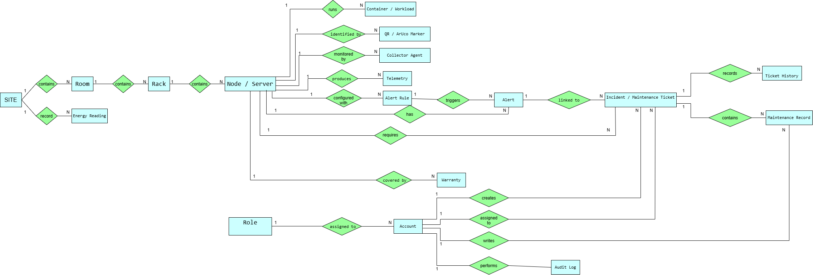

# Sơ đồ thực thể và quan hệ — ERD

## 1. Mục đích

Mô tả các thực thể và quan hệ dữ liệu chính của AR-IMMS,
làm cơ sở thiết kế cơ sở dữ liệu và xây dựng migration.

Đây là ERD tổng quan của hệ thống.
Các thuộc tính, khóa và kiểu dữ liệu chi tiết
được quy định trong thiết kế database và migration.

Không mặc định mọi thực thể trong sơ đồ đã được triển khai.

## 2. Sơ đồ ERD

## 3. Quy ước

| Ký hiệu | Ý nghĩa |
| --- | --- |
| Hình chữ nhật | Thực thể dữ liệu |
| PK | Khóa chính, định danh duy nhất một bản ghi |
| FK | Khóa ngoại, tham chiếu đến bản ghi của thực thể khác |
| Đường nối, mũi tên | Liên kết tham chiếu giữa các thực thể |

Sơ đồ hiện chưa thể hiện đầy đủ ký hiệu bội số và tính tùy chọn.
Quan hệ một–nhiều và các ràng buộc được diễn giải trong tài liệu
và cụ thể hóa bằng migration.

## 4. Các thực thể

| Thực thể | Mô tả |
|---|---|
| Site | Địa điểm triển khai hạ tầng |
| Room | Phòng hoặc khu vực đặt thiết bị thuộc một Site |
| Rack | Tủ hoặc nhóm thiết bị thuộc một Room |
| Node / Server | Máy chủ hoặc máy tính vật lý trong testbed |
| Container / Workload | Ứng dụng, dịch vụ hoặc tác vụ chạy trên Node; container đại diện cho Workload trong testbed |
| QR / ArUco Marker | Dấu nhận diện liên kết với Node để tra cứu bằng Mobile AR |
| Collector Agent | Thành phần thu thập và gửi telemetry của Node |
| Telemetry | Dữ liệu vận hành có thông tin nguồn và thời điểm thu thập |
| Alert Rule | Điều kiện hoặc ngưỡng dùng để phát hiện bất thường |
| Alert | Cảnh báo phát sinh từ tài sản hoặc điều kiện giám sát |
| Role | Vai trò Administrator, Operator hoặc Technician |
| Account | Tài khoản người sử dụng hệ thống |
| Incident / Maintenance Ticket | Phiếu xử lý sự cố hoặc công việc bảo trì |
| Ticket History | Lịch sử thao tác và thay đổi của ticket |
| Maintenance Record | Nội dung kiểm tra, nguyên nhân, hành động và kết quả bảo trì |
| Warranty | Thông tin hoặc hợp đồng bảo hành của thiết bị |
| Audit Log | Nhật ký thao tác thuộc phạm vi kiểm toán |
| Energy Reading | Dữ liệu đo điện năng phục vụ báo cáo và phân tích theo phạm vi được thống nhất |

Warranty và Energy Reading được giữ theo ERD gốc.
Việc triển khai phải được đối chiếu với phạm vi yêu cầu
và task Jira tương ứng.

## 5. Các quan hệ chính

| Quan hệ | Mô tả |
|---|---|
| Site — Room | Một Site có thể chứa nhiều Room; mỗi Room thuộc một Site |
| Room — Rack | Một Room có thể chứa nhiều Rack; mỗi Rack thuộc một Room |
| Rack — Node | Một Rack có thể chứa nhiều Node; mỗi Node thuộc một Rack |
| Node — Workload | Một Node có thể chạy nhiều Workload; mỗi Workload thuộc một Node trong mô hình hiện tại |
| Role — Account | Một Role có thể được gán cho nhiều Account; mỗi Account có một Role |
| Node — Marker | Một Node có thể có nhiều Marker; một định danh Marker đang hoạt động chỉ liên kết với một Node tại một thời điểm |
| Node — Telemetry | Một Node có nhiều mẫu telemetry theo thời gian |
| Node — Alert | Một Node có thể phát sinh nhiều cảnh báo |
| Alert Rule — Alert | Một quy tắc có thể tạo nhiều cảnh báo; một số cảnh báo hệ thống có thể không gắn với quy tắc ngưỡng metric |
| Node — Ticket | Một Node có thể có nhiều ticket xử lý sự cố hoặc bảo trì |
| Alert — Ticket | Mỗi ticket có thể không liên kết hoặc liên kết với một cảnh báo trong mô hình hiện tại |
| Account — Ticket | Tài khoản có quyền tạo ticket; tài khoản phụ trách có thể chưa được phân công |
| Ticket — Ticket History | Một ticket có nhiều bản ghi lịch sử |
| Ticket — Maintenance Record | Một ticket có thể có nhiều bản ghi bảo trì |
| Site — Energy Reading | Một Site có nhiều bản ghi điện năng theo thời gian |
| Account — Audit Log | Tài khoản có thể thực hiện nhiều thao tác được ghi audit; sự kiện tự động có thể không gắn Account |

Quan hệ Collector Agent, Warranty và phạm vi telemetry của Workload
cần được cụ thể hóa khi thiết kế bảng dữ liệu tương ứng.

## 6. Quy tắc thiết kế

### 6.1. Cấu trúc tài sản

Cấu trúc hạ tầng:

Site → Room → Rack → Node → Workload

Không liên kết tài sản với tài sản cha không tồn tại.

Mô hình hiện tại gắn một Workload với một Node.
Nếu hỗ trợ Workload phân tán trên nhiều Node,
phải mở rộng mô hình quan hệ.

### 6.2. Tài khoản và vai trò

Mỗi Account có một Role.

Nếu cho phép một tài khoản mang nhiều vai trò,
cần bổ sung quan hệ trung gian Account Role
và cập nhật cơ chế phân quyền.

### 6.3. Marker

Một định danh Marker đang hoạt động không được
đồng thời trỏ tới nhiều Node.

Thay đổi liên kết Marker phải được ghi nhận
theo chính sách audit.

### 6.4. Cảnh báo và ticket

Ticket có thể được tạo mà không cần có cảnh báo,
ví dụ bảo trì chủ động.

Mỗi ticket liên kết tối đa một cảnh báo trong mô hình hiện tại.
Nếu cần gom nhiều cảnh báo vào một ticket,
phải bổ sung quan hệ liên kết.

Vòng đời cảnh báo được quản lý riêng với vòng đời ticket.

### 6.5. Phân công và bảo trì

Ticket có thể chưa được phân công.

Khi phân công, người phụ trách phải là Technician
đang hoạt động và đáp ứng quyền được quy định.

Thay đổi người phụ trách, cập nhật tiến độ,
gửi kết quả và phê duyệt đóng được ghi trong lịch sử ticket.

Mỗi Maintenance Record xác định người thực hiện
và nội dung xử lý; tài sản liên quan được xác định qua ticket.

### 6.6. Audit Log

Audit có thể phát sinh từ người sử dụng hoặc xử lý tự động.

Với sự kiện tự động, phải xác định được thành phần thực hiện
dù không có Account tương ứng.

Ứng dụng không cung cấp thao tác sửa hoặc xóa audit tùy ý.

### 6.7. Energy Reading

Dữ liệu điện năng phải xác định nguồn, đơn vị,
phạm vi và thời gian đo.

Dữ liệu mô phỏng phải được ghi rõ.

Chỉ tính PUE khi có đủ dữ liệu tổng điện năng cơ sở
và điện năng thiết bị IT trong cùng phạm vi,
cùng khoảng thời gian.

## 7. Quan hệ với database đã triển khai

Backend lõi đã sử dụng các bảng:

| Thực thể | Bảng |
|---|---|
| Role | roles |
| Account | users |
| Site | sites |
| Room | rooms |
| Rack | racks |
| Node / Server | nodes |
| Workload | workloads |

Tên thực thể nghiệp vụ có thể khác tên bảng.

Các thực thể còn lại được triển khai theo task tương ứng.
Không tạo bảng mới chỉ vì thực thể xuất hiện trong ERD
khi chưa đối chiếu thiết kế và migration hiện có.

## 8. Nội dung cần hoàn thiện ở thiết kế chi tiết

- Thuộc tính, khóa chính, khóa ngoại và kiểu dữ liệu.
- Quan hệ telemetry với Node và Workload.
- Cách lưu thông tin đăng ký và xác thực Agent.
- Quan hệ và ràng buộc dữ liệu bảo hành.
- Lịch sử liên kết Marker và vị trí tài sản.
- Ràng buộc duy nhất và chỉ mục phục vụ truy vấn.
- Chính sách lưu giữ telemetry, lịch sử và audit.
- Cơ chế bảo vệ audit tại tầng lưu trữ.
- Thiết kế Energy Reading nếu thuộc phạm vi triển khai.

## 9. Tài liệu liên quan

- [Kiến trúc hệ thống](system-architecture.md)
- [Yêu cầu chức năng](../02-functional-requirements/functional-requirements.md)
- [Quy tắc nghiệp vụ](../02-functional-requirements/business-rules.md)
- [Yêu cầu phi chức năng](../03-non-functional-requirements/non-functional-requirements.md)
