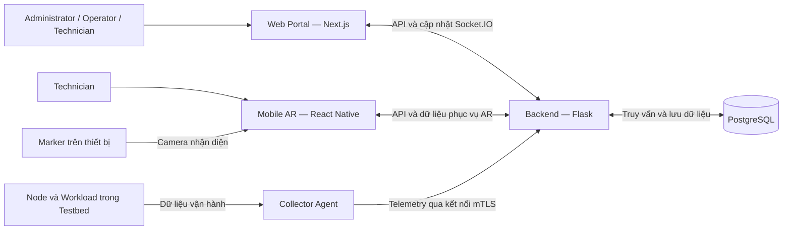

# Kiến trúc hệ thống AR-IMMS

## 1. Mục đích

Mô tả các thành phần chính và cách trao đổi dữ liệu
trong hệ thống AR-IMMS.

Kiến trúc được đối chiếu với yêu cầu chức năng,
yêu cầu phi chức năng và phạm vi công việc đã thống nhất.

Tài liệu mô tả kiến trúc mục tiêu.
Trạng thái triển khai được theo dõi trong Jira và báo cáo kiểm thử.

## 2. Tổng quan kiến trúc

AR-IMMS gồm các thành phần:

- Web Management Portal.
- Mobile AR.
- Backend API.
- Cơ sở dữ liệu.
- Collector Agent.
- Mini Data Center Testbed.

Sơ đồ thể hiện thành phần và luồng trao đổi chính.
Chi tiết endpoint, giao thức Agent và sự kiện Socket.IO
được quy định trong tài liệu hợp đồng API.

## 3. Trách nhiệm các thành phần

| Thành phần | Công nghệ | Trách nhiệm |
|---|---|---|
| Web Portal | Next.js, TypeScript | Giao diện quản trị, quản lý tài sản, giám sát và điều phối công việc |
| Mobile AR | React Native trên Android, tích hợp AR theo thiết kế | Nhận diện marker, tra cứu thiết bị và cập nhật kết quả bảo trì |
| Backend | Python, Flask | Xác thực, phân quyền, xử lý nghiệp vụ và cung cấp dữ liệu |
| Cơ sở dữ liệu | PostgreSQL | Lưu dữ liệu nghiệp vụ; tổ chức lưu telemetry theo thiết kế dữ liệu |
| Collector Agent | Theo thiết kế Agent | Thu thập, gắn định danh và gửi dữ liệu vận hành |
| Testbed | Máy tính vật lý và container | Cung cấp môi trường triển khai, phát sinh tải và kiểm chứng |

## 4. Tổ chức Backend

Backend được tổ chức theo các nhóm chức năng:

| Nhóm | Trách nhiệm |
|---|---|
| Xác thực và tài khoản | Đăng nhập, JWT, kiểm tra tài khoản và RBAC |
| Tài sản | Quản lý Site, Room, Rack, Node và Workload |
| Tiếp nhận telemetry | Xác thực nguồn gửi, kiểm tra và lưu dữ liệu |
| Giám sát và cảnh báo | Theo dõi trạng thái, đánh giá điều kiện và quản lý cảnh báo |
| Ticket và bảo trì | Phân công, cập nhật kết quả và phê duyệt đóng |
| Marker và AR | Ánh xạ marker tới tài sản, cung cấp dữ liệu phục vụ AR |
| Audit và cấu hình | Ghi nhận thao tác, tra cứu nhật ký và quản lý cấu hình |

Các nhóm này mô tả trách nhiệm logic.
Không đồng nghĩa tất cả module đã có trong mã nguồn.

## 5. Luồng xác thực và truy cập

1. Người sử dụng nhập email và mật khẩu trên ứng dụng.
2. Ứng dụng gửi yêu cầu đăng nhập đến Backend.
3. Backend kiểm tra tài khoản và mật khẩu.
4. Nếu hợp lệ, Backend trả JWT.
5. Ứng dụng gửi JWT khi gọi API được bảo vệ.
6. Backend xác minh phiên, trạng thái tài khoản và quyền thao tác.
7. Backend trả dữ liệu trong phạm vi được phép.

Ứng dụng có thể dùng thông tin vai trò để hiển thị menu.
Quyết định cấp quyền cuối cùng được thực hiện tại Backend.

Frontend hiện lưu thông tin phiên bằng sessionStorage.
Đây là cơ chế triển khai hiện tại, có thể được thay đổi
khi nhóm cập nhật thiết kế xác thực.

## 6. Luồng telemetry và giám sát

1. Agent thu thập dữ liệu từ Node và Workload theo cấu hình.
2. Agent gắn định danh nguồn và thời điểm thu thập.
3. Agent gửi dữ liệu qua kết nối được bảo vệ bằng mTLS.
4. Backend xác thực Agent và kiểm tra dữ liệu.
5. Backend lưu dữ liệu hợp lệ và xử lý trạng thái liên quan.
6. Chức năng cảnh báo đánh giá điều kiện đã cấu hình.
7. Backend cung cấp dữ liệu cho Web và Mobile theo quyền truy cập.
8. Web nhận cập nhật qua Socket.IO theo thiết kế sự kiện.

Chu kỳ thu thập, gửi dữ liệu và độ trễ cập nhật
là các thông số khác nhau.

Giá trị thời gian áp dụng theo NFR.
Khi mất kết nối, giao diện phải thể hiện trạng thái
và thời điểm cập nhật cuối.

## 7. Luồng tra cứu bằng Mobile AR

1. Technician đăng nhập trên ứng dụng Mobile.
2. Camera nhận diện QR Code hoặc ArUco theo thiết kế.
3. Ứng dụng gửi định danh marker đến Backend.
4. Backend kiểm tra quyền và tìm tài sản tương ứng.
5. Backend trả thông tin thiết bị và dữ liệu được phép xem.
6. Ứng dụng hiển thị thông tin trong giao diện AR.

Nhận diện marker không thay thế kiểm tra quyền truy cập.

## 8. Luồng xử lý sự cố và bảo trì

1. Operator xem cảnh báo hoặc xác định nhu cầu bảo trì.
2. Operator tạo ticket và phân công Technician.
3. Technician kiểm tra thiết bị và cập nhật kết quả.
4. Operator kiểm tra kết quả và phê duyệt đóng ticket.
5. Hệ thống lưu lịch sử và audit theo phạm vi yêu cầu.

Vòng đời ticket và cảnh báo được quản lý riêng,
theo quy tắc nghiệp vụ đã thống nhất.

## 9. Dữ liệu và cấu hình

- Quan hệ tài sản được tổ chức:
  Site → Room → Rack → Node → Workload.
- Khóa ngoại và ràng buộc dữ liệu được quản lý bằng migration.
- Backend sử dụng biến môi trường để cấu hình kết nối database.
- Frontend sử dụng NEXT_PUBLIC_API_URL để xác định địa chỉ Backend.
- Mật khẩu database và JWT secret chỉ được cấu hình phía Backend.
- Không đặt thông tin bí mật trong biến NEXT_PUBLIC_*.
- File .env.example chỉ chứa cấu hình mẫu.
- Dữ liệu mẫu chỉ phục vụ môi trường phát triển hoặc kiểm thử.

## 10. Môi trường phát triển

| Thành phần | Địa chỉ mặc định trên máy phát triển |
|---|---|
| Web Portal | http://localhost:3001 |
| Backend | http://localhost:5000 |
| PostgreSQL | localhost:5432 hoặc cổng được cấu hình |

Các địa chỉ trên chỉ là cấu hình phát triển.
Khi triển khai hoặc dùng database chung,
phải cấu hình địa chỉ tương ứng.

Backend phải cho phép CORS từ địa chỉ Web được nhóm sử dụng.

## 11. Kiểm chứng kiến trúc

- Web gọi được API kiểm tra sức khỏe của Backend.
- Các API được bảo vệ kiểm tra JWT và RBAC.
- Backend truy vấn được database đã khởi tạo bằng migration.
- Agent hợp lệ gửi được telemetry; nguồn không hợp lệ bị từ chối.
- Giao diện hiển thị dữ liệu và thời điểm cập nhật.
- Marker dẫn đến đúng tài sản.
- Ticket tuân theo quyền và vòng đời được quy định.
- Audit ghi nhận các thao tác thuộc phạm vi yêu cầu.

Kết quả kiểm chứng phải được ghi nhận theo từng task;
không suy ra toàn bộ kiến trúc đã hoàn thành từ việc build thành công.