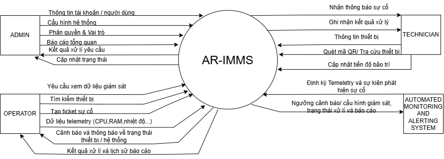
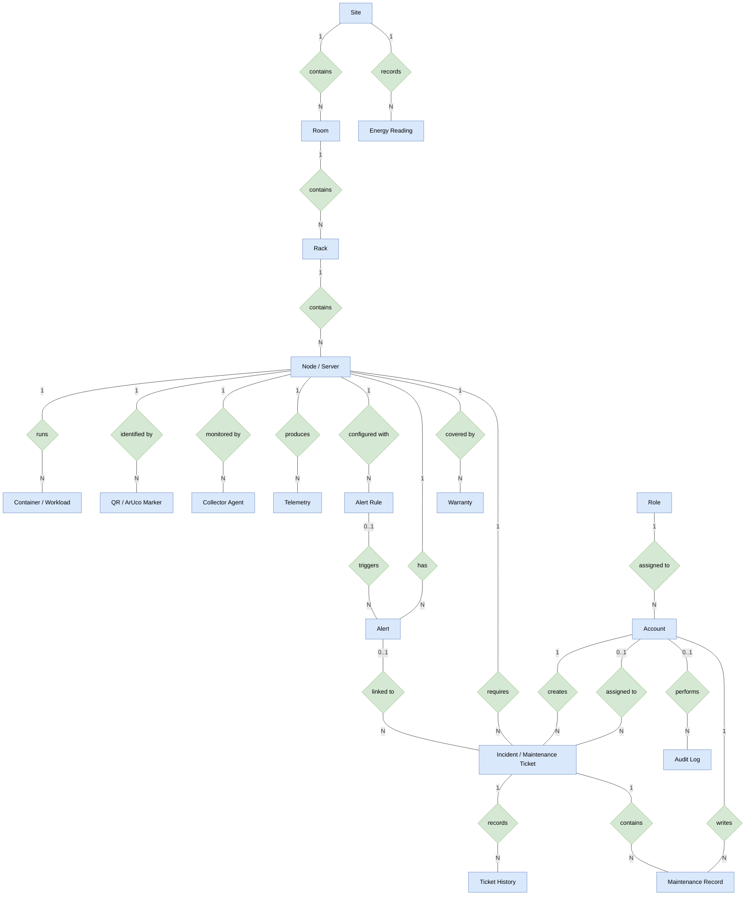

# Phân tích bối cảnh và vấn đề của hệ thống AR-IMMS

##  Mục đích,Bối cảnh vận hành
Tài liệu phân tích bối cảnh giám sát và bảo trì hạ tầng máy chủ,
xác định những khó khăn khi dữ liệu vận hành tách biệt với vị trí
thiết bị vật lý, từ đó làm rõ nhu cầu xây dựng AR-IMMS.
Kết quả phân tích là đầu vào để xác định mục tiêu dự án,
phạm vi, tác nhân và yêu cầu hệ thống ở các tài liệu tiếp theo.

Trong Data Center và Server Room, các máy chủ được bố trí
trong nhiều rack và có thể có hình thức bên ngoài tương tự nhau.
Mỗi máy chủ có thể chạy nhiều ứng dụng, service hoặc container.
Nhân viên vận hành theo dõi các chỉ số như CPU, RAM, lưu lượng
mạng và trạng thái dịch vụ thông qua dashboard và công cụ
giám sát tập trung.
Dashboard cung cấp thông tin vận hành nhưng kỹ thuật viên
vẫn cần xác định thiết bị tương ứng tại hiện trường.
Việc liên kết giữa thông tin số và vị trí phần cứng là vấn đề
trọng tâm mà AR-IMMS hướng tới giải quyết.

##  Quy trình xử lý sự cố làm cơ sở phân tích
Quy trình dưới đây được mô tả theo bối cảnh của đề tài,
cần được xác nhận thêm khi khảo sát người sử dụng.

1. Hệ thống giám sát phát hiện chỉ số bất thường hoặc mất kết nối.
2. Nhân viên vận hành kiểm tra cảnh báo và thông tin thiết bị.
3. Nhân viên vận hành xác định vị trí và giao việc kiểm tra.
4. Kỹ thuật viên đối chiếu thông tin để tìm rack và máy chủ.
5. Kỹ thuật viên tra cứu telemetry, log và lịch sử bảo trì.
6. Kỹ thuật viên kiểm tra, xử lý và ghi nhận kết quả.
7. Nhân viên vận hành kiểm tra kết quả và xác nhận hoàn tất.

Các bước xác định thiết bị và tra cứu thông tin có thể yêu cầu
chuyển đổi giữa dashboard, sơ đồ vị trí và hồ sơ bảo trì.

##  Các vấn đề cần giải quyết
| Mã | Vấn đề | Nguyên nhân trong bối cảnh đề tài | Ảnh hưởng có thể xảy ra |
|---|---|---|---|
| P-01 | Khó xác định đúng thiết bị tại hiện trường | Thông tin cảnh báo chưa liên kết trực quan với vị trí vật lý | Tốn thời gian đối chiếu, có nguy cơ kiểm tra nhầm thiết bị |
| P-02 | Thiếu thông tin chẩn đoán ngay tại thiết bị | Telemetry, workload, log và lịch sử bảo trì nằm ở các giao diện hoặc hồ sơ riêng | Kỹ thuật viên phải tra cứu nhiều nơi |
| P-03 | Quy trình xử lý sự cố thiếu liên kết | Cảnh báo, thiết bị và công việc bảo trì chưa được kết nối xuyên suốt | Khó theo dõi người xử lý, tiến độ và kết quả |
| P-04 | Khó truy vết hoạt động bảo trì | Các thay đổi và kết quả xử lý chưa được ghi nhận thống nhất | Khó kiểm tra lịch sử và tổng hợp báo cáo |

Đây là các vấn đề được xác định từ đề tài.
Mức độ ảnh hưởng thực tế cần được kiểm chứng khi đánh giá testbed.

##  Nhu cầu của các bên sử dụng
| Bên sử dụng | Nhu cầu chính |
|---|---|
| System Administrator | Quản lý tài khoản, quyền truy cập, cấu hình và sức khỏe hệ thống |
| System Operator | Theo dõi hạ tầng theo vị trí, kiểm tra cảnh báo, giao và theo dõi ticket |
| Technician | Nhận diện đúng thiết bị, xem thông tin tại hiện trường và cập nhật kết quả bảo trì |

Ma trận quyền chi tiết được trình bày trong tài liệu AI-5.

##  Định hướng giải pháp
AR-IMMS kết nối tài sản vật lý, dữ liệu vận hành, cảnh báo
và quy trình bảo trì trong cùng một nền tảng.

###  Liên kết tài sản bằng Digital Twin
Mô hình hóa hạ tầng theo cấu trúc:

Site → Room → Rack → Node/Server → Container/Workload.

Cấu trúc này cung cấp thông tin về vị trí và quan hệ giữa
thiết bị với workload đang chạy.

###  Cung cấp dữ liệu vận hành theo thời gian thực
Collector Agent thu thập telemetry từ máy chủ và gửi về backend.
Web Portal và Mobile AR cung cấp dữ liệu liên quan tới thiết bị,
đồng thời thể hiện rõ khi dữ liệu đã cũ hoặc kết nối bị gián đoạn.

###  Cung cấp thông tin theo ngữ cảnh bằng AR
Marker được liên kết với định danh thiết bị.
Kỹ thuật viên dùng điện thoại Android nhận diện marker để
truy cập trạng thái, telemetry, cảnh báo và thông tin bảo trì
của đúng thiết bị tại hiện trường.

###  Liên kết cảnh báo với công việc bảo trì
Cảnh báo được liên kết với tài sản và ticket.
Operator giao công việc; Technician ghi nhận quá trình xử lý,
nguyên nhân và kết quả; Operator phê duyệt đóng ticket.

##  Môi trường triển khai và giới hạn đánh giá
Dự án được triển khai trên Mini Data Center Testbed.

- Các máy tính vật lý đại diện cho node/server.
- Nhóm thiết bị đại diện cho rack.
- Ứng dụng hoặc container đại diện cho workload.
- Marker được gắn lên thiết bị để thử nghiệm nhận diện.

Kết quả đánh giá phản ánh điều kiện của testbed.
Việc áp dụng cho Data Center thực tế cần được đánh giá thêm
về quy mô, môi trường vận hành và yêu cầu bảo mật.

##  Lợi ích kỳ vọng và cách đánh giá
| Lợi ích kỳ vọng | Hướng đánh giá |
|---|---|
| Xác định thiết bị thuận tiện hơn | So sánh thời gian và độ chính xác khi tìm thiết bị bằng đối chiếu thủ công và bằng AR |
| Giảm thao tác tra cứu thông tin | Ghi nhận số bước và thời gian truy cập telemetry, log, lịch sử bảo trì |
| Theo dõi công việc bảo trì rõ ràng hơn | Kiểm tra khả năng truy vết từ cảnh báo đến ticket và kết quả xử lý |

Chưa kết luận hệ thống giảm MTTR khi chưa có kết quả thực nghiệm.
Nếu đánh giá MTTR, cần xác định rõ thời điểm bắt đầu, kết thúc
và sử dụng các kịch bản sự cố có thể so sánh.
## Sơ đồ ngữ cảnh

# Bối cảnh hoạt động của hệ thống AR-IMMS

## 1. Môi trường hoạt động

- **Nền tảng:** Web Management Portal trên trình duyệt và ứng dụng Mobile AR trên Android.
- **Kết nối:** Agent, Backend, Web và Mobile cần kết nối mạng để truyền và cập nhật dữ liệu. Khi mất kết nối, hệ thống phải thể hiện rõ trạng thái và thời điểm cập nhật cuối.
- **Hạ tầng:** Backend NestJS, Web Next.js, Mobile React Native, truyền dữ liệu thời gian thực bằng [Socket.IO](https://socket.io/) và lưu trữ dữ liệu bằng cơ sở dữ liệu quan hệ/time-series.
- **Môi trường thử nghiệm:** Mini Data Center Testbed, sử dụng máy tính vật lý đại diện cho server và container đại diện cho workload.

## 2. Người sử dụng dự kiến

| Vai trò | Trách nhiệm |
|---|---|
| System Administrator | Quản lý tài khoản, phân quyền, cấu hình, sức khỏe hệ thống và audit log |
| System Operator | Quản lý tài sản, giám sát telemetry, xử lý cảnh báo, phân công và phê duyệt đóng ticket |
| Technician | Nhận công việc, quét marker bằng AR, kiểm tra thiết bị và cập nhật kết quả bảo trì |

## 3. Các tương tác trong sơ đồ ngữ cảnh

| Đối tượng | Thông tin gửi tới AR-IMMS | Thông tin nhận từ AR-IMMS |
|---|---|---|
| Administrator | Yêu cầu quản trị | Thông tin cấu hình, sức khỏe hệ thống và audit |
| Operator | Yêu cầu quản lý, cấu hình cảnh báo và phân công ticket | Telemetry, cảnh báo và báo cáo |
| Technician | Thông tin marker và cập nhật bảo trì | Thông tin thiết bị, telemetry và ticket được giao |
| Collector Agent | Telemetry và trạng thái kết nối | Cấu hình thu thập theo thiết kế |
# Mục tiêu của dự án AR-IMMS

## 1. Mục đích tài liệu
Tài liệu xác định mục tiêu tổng quát, các mục tiêu cụ thể
và cách đánh giá kết quả của dự án AR-IMMS.

Các mục tiêu được xây dựng từ những vấn đề đã phân tích
trong AI-2, làm cơ sở xác định phạm vi, yêu cầu và kế hoạch
kiểm thử của hệ thống.

## 2. Mục tiêu tổng quát
Xây dựng hệ thống giám sát và bảo trì hạ tầng máy chủ
tích hợp thực tế tăng cường, liên kết vị trí thiết bị vật lý
với dữ liệu vận hành, cảnh báo và công việc bảo trì.

Hệ thống hỗ trợ Operator theo dõi hạ tầng và điều phối
xử lý sự cố, đồng thời cung cấp cho Technician thông tin
theo ngữ cảnh ngay tại thiết bị cần kiểm tra.

Tính khả thi của giải pháp được triển khai và đánh giá
trên Mini Data Center Testbed.

## 3. Các mục tiêu cụ thể
### OBJ-01 Liên kết thiết bị vật lý với tài sản kỹ thuật số
Biểu diễn hạ tầng theo cấu trúc:
Site → Room → Rack → Node/Server → Container/Workload.

Mỗi thiết bị được liên kết với vị trí, thông tin tài sản
và marker nhận diện tương ứng.

**Cách kiểm chứng:**
- Đối chiếu thông tin trên hệ thống với thiết bị trong testbed.
- Kiểm tra quan hệ giữa node, rack và workload.
- Quét marker và xác nhận hệ thống trả về đúng thiết bị.

### OBJ-02 Cung cấp dữ liệu giám sát kịp thời

Thu thập và cung cấp telemetry của server, trạng thái
container và trạng thái kết nối để người dùng theo dõi
hoạt động hạ tầng.

**Tiêu chí đánh giá:**
- Chu kỳ thu thập telemetry mặc định là 5 giây và cấu hình được.
- Node được xác định không khả dụng khi không nhận telemetry
  trong hơn 90 giây.
- Giao diện thể hiện thời điểm cập nhật cuối và dữ liệu cũ.
- Agent tự thử gửi lại và tiếp tục hoạt động sau khi kết nối lại.

### OBJ-03 Hỗ trợ xác định và kiểm tra thiết bị bằng AR

Cung cấp ứng dụng Android nhận diện marker QR/ArUco
đã liên kết với thiết bị và hiển thị thông tin vận hành
trên giao diện camera.

**Cách kiểm chứng:**
- Quét marker trên các thiết bị khác nhau trong testbed.
- Xác nhận overlay hiển thị đúng thông tin của thiết bị được quét.
- Kiểm tra khả năng cập nhật telemetry trong phiên AR.

### OBJ-04 Liên kết cảnh báo với quy trình bảo trì

Hỗ trợ quy trình từ phát hiện bất thường, xác nhận cảnh báo,
tạo và phân công ticket đến ghi nhận kết quả và phê duyệt đóng.

**Cách kiểm chứng:**
- Tạo sự cố có kiểm soát trong testbed.
- Theo dõi luồng cảnh báo → ticket → phân công → xử lý
  → yêu cầu đóng → Operator phê duyệt.
- Kiểm tra khả năng ngăn cảnh báo trùng cho cùng sự cố.
- Kiểm tra việc lưu nguyên nhân, hành động khắc phục
  và kết quả bảo trì.

### OBJ-05 Quản lý lịch sử tài sản và truy vết hoạt động

Lưu thông số phần cứng, thông tin bảo hành, lịch sử bảo trì
và audit log để hỗ trợ quản lý vòng đời tài sản.

**Cách kiểm chứng:**
- Truy xuất lịch sử bảo trì theo thiết bị.
- Kiểm tra thông tin và cảnh báo bảo hành.
- Đối chiếu audit log với thay đổi cấu hình và cập nhật ticket.
- Kiểm tra người dùng thông thường không thể sửa hoặc xóa
  audit log thông qua chức năng được cung cấp.

### OBJ-06 Cung cấp báo cáo phục vụ vận hành

Cung cấp dữ liệu lịch sử và báo cáo theo Site, Room, Rack
và Node để hỗ trợ phân tích xu hướng tài nguyên,
lập kế hoạch công suất và theo dõi hoạt động bảo trì.

**Cách kiểm chứng:**
- Đối chiếu biểu đồ và báo cáo với dữ liệu đã lưu.
- Kiểm tra bộ lọc thời gian và cấp tài sản.
- Với phân tích điện năng/PUE, xác định rõ nguồn dữ liệu,
  đơn vị và khoảng đo.
- Nếu sử dụng dữ liệu mô phỏng, phải ghi rõ trên báo cáo.
- Không suy ra PUE chỉ từ mức sử dụng CPU hoặc RAM.

### OBJ-07 Đảm bảo truy cập có kiểm soát và khả năng mở rộng PoC

Áp dụng xác thực, phân quyền và định danh agent,
đồng thời cho phép bổ sung node mà không sửa code service lõi.

**Tiêu chí đánh giá:**
- Phân quyền theo Administrator, Operator và Technician.
- Agent sử dụng mTLS khi gửi telemetry.
- Node mới bắt đầu streaming và xuất hiện trong Digital Twin
  trong tối đa 5 phút kể từ lúc đăng ký.
- Việc bổ sung node chỉ cần cấu hình credentials
  và endpoint address theo quy trình đã thiết kế.

## 4. Đánh giá hiệu quả hỗ trợ bảo trì

Dự án kỳ vọng giúp kỹ thuật viên xác định đúng thiết bị
và truy cập thông tin chẩn đoán thuận tiện hơn.

Để đánh giá, nhóm thực hiện các kịch bản có thể so sánh:

1. Xác định thiết bị bằng cách đối chiếu thông tin thủ công.
2. Xác định cùng thiết bị bằng ứng dụng AR.
3. Ghi nhận thời gian, độ chính xác và các thao tác tra cứu.
4. Tổng hợp kết quả và phân tích các trường hợp thất bại.

Nếu đánh giá MTTR, cần thống nhất thời điểm bắt đầu,
thời điểm kết thúc và điều kiện thực hiện từng kịch bản.

Không khẳng định mức giảm thời gian hoặc tỷ lệ cải thiện
khi chưa có kết quả thực nghiệm.

## 5. Sản phẩm dự kiến bàn giao
- Mini Data Center Testbed và Collector Agent.
- Backend API và Real-Time Telemetry Engine.
- Next.js Web Management Portal.
- React Native Mobile AR Application trên Android.
- Module cảnh báo, incident và ticket bảo trì.
- Module vòng đời tài sản và audit.
- Báo cáo và phân tích dữ liệu lịch sử.
- Mã nguồn, bộ kiểm thử, script triển khai và tài liệu sử dụng.
## 6. Giới hạn của việc đánh giá
Các mục tiêu được kiểm chứng trong điều kiện testbed.
Kết quả chưa đại diện cho mọi Data Center thực tế.
Số lượng node, thời lượng thử nghiệm, thiết bị Android
và các mức tải kiểm thử phải được nhóm xác định,
ghi nhận trong kế hoạch đánh giá.
Các mục tiêu trong tài liệu là tiêu chí dự kiến,
không phải xác nhận rằng hệ thống đã đạt được.
---

## 7. Kế hoạch triển khai và kiểm thử tích hợp

Để đảm bảo các mục tiêu của dự án AR-IMMS được hiện thực hóa đúng tiến độ và đạt các tiêu chí kiểm chứng đã đề ra, kế hoạch thực hiện được chia thành các giai đoạn chính:

### 7.1. Giai đoạn 1: Chuẩn bị hạ tầng Testbed và Collector Agent
* **Thiết lập phần cứng & mạng:** Cấu hình các máy tính vật lý làm node/server, thiết lập nhóm rack và kết nối mạng nội bộ cho Mini Data Center.
* **Phát triển Collector Agent:** Xây dựng script/chương trình chạy trên các node để định kỳ thu thập các chỉ số telemetry (CPU, RAM, Network, Disk) với chu kỳ mặc định 5 giây.
* **Cơ chế bảo mật agent:** Tích hợp xác thực mTLS giữa Collector Agent và Backend để đảm bảo an toàn truyền dữ liệu.

### 7.2. Giai đoạn 2: Xây dựng Backend Core & Digital Twin Engine
* **Xây dựng mô hình cơ sở dữ liệu:** Thiết kế cấu trúc phân cấp tài sản từ `Site → Room → Rack → Node/Server → Container/Workload`.
* **Xử lý Real-Time Telemetry:** Phát triển engine tiếp nhận dữ liệu, xử lý trạng thái kết nối (đánh dấu node không khả dụng nếu mất tín hiệu trên 90 giây) và cơ chế tự kết nối lại của agent.
* **Module phân quyền RBAC:** Triển khai cơ chế phân định rõ quyền hạn cho 3 nhóm người dùng: *System Administrator*, *System Operator* và *Technician*.

### 7.3. Giao đoạn 3: Phát triển Web Management Portal & Mobile AR App
* **Web Portal (Next.js):** Xây dựng giao diện trực quan giúp Operator và Administrator giám sát trạng thái hệ thống, quản lý sơ đồ Digital Twin, tiếp nhận cảnh báo và phân công ticket.
* **Mobile AR App (React Native - Android):** Phát triển ứng dụng trên thiết bị di động Android tích hợp thư viện quét marker QR/ArUco, hiển thị thông tin dạng overlay theo ngữ cảnh thiết bị tại hiện trường.
* **Module Cảnh báo & Ticket:** Hoàn thiện luồng tự động chuyển đổi cảnh báo thành ticket, ngăn chặn việc tạo trùng lặp cảnh báo cho cùng một sự cố, đồng thời ghi nhận nhật ký bảo trì và audit log.

### 7.4. Giai đoạn 4: Kiểm thử, Đánh giá và Hoàn thiện tài liệu
* **Kiểm thử tích hợp hệ thống:** Chạy thử nghiệm toàn bộ luồng từ lúc phát sinh bất thường, tạo ticket, kỹ thuật viên quét mã AR xử lý cho đến khi Operator phê duyệt đóng ticket.
* **Đánh giá thực nghiệm:** Thực hiện các kịch bản so sánh thời gian và độ chính xác giữa phương pháp đối chiếu thủ công và sử dụng ứng dụng AR.
* **Đóng gói sản phẩm:** Hoàn thiện mã nguồn, kịch bản test, script triển khai tự động và bộ tài liệu hướng dẫn sử dụng chi tiết bàn giao cho hội đồng đánh giá.

## .8  XÁC ĐỊNH CÁC TÁC NHÂN CỦA HỆ THỐNG AR-IMMS

## 8.1 Mục tiêu
Xác định các tác nhân tương tác với hệ thống AR-IMMS, làm rõ vai trò và trách nhiệm của từng tác nhân trong quá trình quản lý, giám sát và bảo trì Mini Data Center Testbed.

## 8.2 Nội dung thực hiện
Xác định các tác nhân chính của hệ thống AR-IMMS và mô tả vai trò, chức năng của từng tác nhân, bao gồm:
- **System Administrator (Quản trị viên hệ thống)**: quản lý tài khoản người dùng, phân quyền, cấu hình hệ thống; theo dõi tình trạng dịch vụ và data collector; quản lý môi trường thử nghiệm, xem audit log và lịch sử thay đổi cấu hình.
- **System Operator (Nhân viên vận hành hệ thống)**: quản lý rack, server, workload và liên kết QR/ArUco; theo dõi telemetry và Digital Twin; cấu hình, xác nhận cảnh báo; tạo, phân công và theo dõi incident/maintenance ticket; quản lý tài sản và xem báo cáo vận hành.
- **Technician (Kỹ thuật viên)**: xem ticket được giao, xác định rack/server cần kiểm tra, quét QR/ArUco bằng ứng dụng AR; xem telemetry, cảnh báo và thông tin chẩn đoán; cập nhật tiến độ, ghi nhận nguyên nhân, biện pháp khắc phục và kết quả bảo trì.
- **Automated Monitoring and Alerting System (Hệ thống giám sát và cảnh báo tự động)**: thu thập telemetry và trạng thái kết nối; phát hiện server không khả dụng hoặc chỉ số vượt ngưỡng; tạo/cập nhật cảnh báo, lưu telemetry lịch sử và ghi lại hoạt động quan trọng vào audit log.
Xác định mối quan hệ và giới hạn tương tác của các tác nhân với chức năng hệ thống, phù hợp với cơ chế xác thực và phân quyền theo vai trò (RBAC).

## 8.3 Phạm vi xác định tác nhân
Phạm vi gồm ba nhóm người dùng chính: System Administrator, System Operator và Technician; cùng tác nhân tự động Automated Monitoring and Alerting System. Các tác nhân tương tác với hệ thống trong môi trường Mini Data Center Testbed để quản trị, vận hành, giám sát, cảnh báo và thực hiện bảo trì.

## 8.4 Kết quả bàn giao
Tài liệu mô tả 4 tác nhân của hệ thống AR-IMMS, bao gồm:
Tên và mục đích của từng tác nhân.
Vai trò, trách nhiệm và các chức năng tương ứng.
Mối quan hệ giữa tác nhân với các chức năng giám sát, cảnh báo, quản lý tài sản, ticket và bảo trì.
Thông tin làm cơ sở xây dựng sơ đồ Use Case và đặc tả yêu cầu hệ thống.

## 8.5 Tiêu chí đánh giá
Tài liệu được đánh giá dựa trên việc xác định đầy đủ 4 tác nhân; mô tả rõ vai trò và trách nhiệm của từng tác nhân; phân biệt đúng quyền quản trị, vận hành và xử lý bảo trì; bảo đảm nội dung phù hợp với yêu cầu AR-IMMS và cơ chế phân quyền RBAC.

## 8.6 Kết luận
Việc xác định các tác nhân giúp làm rõ những đối tượng tương tác với hệ thống AR-IMMS và trách nhiệm của từng đối tượng. Đây là cơ sở để thiết kế chức năng, phân quyền và xây dựng sơ đồ Use Case cho hệ thống.

## 9. Xây dựng yêu cầu phần mềm 

## 9.1. Phạm vi hệ thống

* Xác thực người dùng và kiểm soát quyền truy cập theo vai trò.
* Quản lý tài sản theo cấu trúc: `Site` → `Room` → `Rack` → `Server/Node` → `Container/Workload`.
* Tiếp nhận, kiểm tra, lưu trữ và hiển thị dữ liệu telemetry.
* Theo dõi trạng thái hạ tầng, phát hiện bất thường và quản lý cảnh báo.
* Tạo và theo dõi ticket sự cố hoặc yêu cầu bảo trì.
* Hỗ trợ tra cứu thiết bị bằng QR Code/ArUco và ứng dụng Mobile AR.
* Ghi nhật ký thao tác quan trọng để phục vụ kiểm toán và truy vết.

---

## 9.2. Tác nhân hệ thống

| Tác nhân | Vai trò |
| :--- | :--- |
| **System Administrator** | Quản trị hệ thống, quản lý tài khoản, phân quyền và các thiết lập được cấp. |
| **System Operator** | Theo dõi hạ tầng, tra cứu dữ liệu, quản lý cảnh báo và điều phối xử lý sự cố. |
| **Technician** | Tra cứu thiết bị, tiếp nhận nhiệm vụ và cập nhật hoạt động kiểm tra/bảo trì tại hiện trường. |
| **Automated Monitoring and Alerting System** | Tự động tiếp nhận hoặc xử lý dữ liệu giám sát, kiểm tra điều kiện cảnh báo và hỗ trợ phát hiện bất thường. |

---

## 9.3. Yêu cầu chức năng (FR-01 đến FR-15)

### FR-01 — Đăng nhập và xác thực
* **Mô tả:** Cho phép người dùng đăng nhập bằng tài khoản hợp lệ. Backend xác thực thông tin và cấp JWT để truy cập các API được bảo vệ.
* **Tác nhân:** System Administrator, System Operator, Technician.
* **Kết quả mong đợi:** Người dùng được xác thực và chỉ truy cập tài nguyên yêu cầu đăng nhập.

### FR-02 — Quản lý tài khoản và quyền truy cập
* **Mô tả:** Cho phép người có thẩm quyền xem, tạo, cập nhật và quản lý tài khoản. Hệ thống kiểm soát quyền theo vai trò Administrator, Operator và Technician.
* **Tác nhân:** System Administrator, System Operator, Technician.
* **Kết quả mong đợi:** Tài khoản được quản lý nhất quán; thao tác không đủ quyền bị từ chối.

### FR-03 — Quản lý tài sản hạ tầng
* **Mô tả:** Quản lý Site, Room, Rack, Server/Node và Container/Workload. Mỗi tài sản có định danh và liên kết đúng với tài sản cấp trên.
* **Tác nhân:** System Administrator, System Operator.
* **Kết quả mong đợi:** Tài sản được lưu trữ và liên kết theo cấu trúc phân cấp đã quy định.

### FR-04 — Tra cứu cấu trúc và thông tin tài sản
* **Mô tả:** Cho phép tra cứu tài sản, vị trí, thông số kỹ thuật và quan hệ giữa các cấp tài sản theo quyền được cấp.
* **Tác nhân:** System Operator, Technician.
* **Kết quả mong đợi:** Người dùng tra cứu được tài sản và thông tin liên quan.

### FR-05 — Tra cứu thiết bị bằng QR Code/ArUco và Mobile AR
* **Mô tả:** Cho phép kỹ thuật viên quét QR Code hoặc marker ArUco bằng ứng dụng di động để xác định thiết bị và xem thông tin, trạng thái, telemetry, cảnh báo liên quan.
* **Tác nhân:** Technician.
* **Kết quả mong đợi:** Marker được ánh xạ tới đúng tài sản và hiển thị thông tin tương ứng.

### FR-06 — Thu thập dữ liệu telemetry
* **Mô tả:** Tiếp nhận dữ liệu vận hành từ Collector Agent hoặc nguồn thu thập được hệ thống hỗ trợ. Dữ liệu phải gắn với tài sản và có thời điểm ghi nhận.
* **Tác nhân:** Automated Monitoring and Alerting System.
* **Kết quả mong đợi:** Dữ liệu hợp lệ được tiếp nhận và chuyển tới bước xử lý/lưu trữ phù hợp.

### FR-07 — Hiển thị trạng thái hạ tầng
* **Mô tả:** Hiển thị trạng thái hoạt động của server/node và các chỉ số vận hành được hỗ trợ để nhận biết tình trạng bình thường hoặc bất thường.
* **Tác nhân:** System Operator, Technician.
* **Kết quả mong đợi:** Người dùng xem được trạng thái dựa trên dữ liệu hệ thống hiện có.

### FR-08 — Hiển thị telemetry thời gian thực
* **Mô tả:** Cập nhật dữ liệu giám sát trên giao diện thông qua cơ chế truyền dữ liệu thời gian thực hoặc cơ chế cập nhật được hỗ trợ.
* **Tác nhân:** System Operator.
* **Kết quả mong đợi:** Dữ liệu mới được hiển thị theo cơ chế và tần suất đã cấu hình.

### FR-09 — Phát hiện và quản lý cảnh báo
* **Mô tả:** So sánh telemetry với điều kiện hoặc ngưỡng đã cấu hình; tạo, hiển thị và cập nhật trạng thái cảnh báo khi phát hiện bất thường.
* **Tác nhân:** Automated Monitoring and Alerting System, System Operator.
* **Kết quả mong đợi:** Cảnh báo được tạo theo quy tắc và trạng thái được quản lý nhất quán.

### FR-10 — Tạo và phân công ticket sự cố
* **Mô tả:** Cho phép tạo ticket sự cố hoặc yêu cầu bảo trì, ghi nhận thông tin cần thiết và phân công kỹ thuật viên theo quyền được cấp.
* **Tác nhân:** System Operator, System Administrator.
* **Kết quả mong đợi:** Ticket được lưu với mã định danh, trạng thái và người phụ trách nếu đã phân công.

### FR-11 — Theo dõi xử lý sự cố và bảo trì
* **Mô tả:** Cho phép cập nhật và theo dõi trạng thái ticket từ khi tiếp nhận đến khi hoàn tất; lưu thông tin hoạt động bảo trì trong phạm vi hỗ trợ.
* **Tác nhân:** System Operator, Technician.
* **Kết quả mong đợi:** Tiến độ xử lý được cập nhật và tra cứu theo quyền.

### FR-12 — Tra cứu telemetry lịch sử
* **Mô tả:** Cho phép truy vấn dữ liệu telemetry đã lưu theo tài sản, khoảng thời gian và bộ lọc được hệ thống hỗ trợ.
* **Tác nhân:** System Operator, Technician.
* **Kết quả mong đợi:** Kết quả phản ánh dữ liệu lịch sử đã được lưu.

### FR-13 — Quản lý cấu hình giám sát
* **Mô tả:** Cho phép người có thẩm quyền quản lý cấu hình giám sát, ngưỡng cảnh báo và chính sách xử lý dữ liệu trong phạm vi được phê duyệt.
* **Tác nhân:** System Administrator, System Operator.
* **Kết quả mong đợi:** Cấu hình được lưu và áp dụng theo quyền và chính sách đã thống nhất.

### FR-14 — Ghi nhật ký thao tác và kiểm toán
* **Mô tả:** Ghi nhận các thao tác quan trọng như thay đổi cấu hình, quản lý tài sản, thay đổi quyền và xử lý sự cố để phục vụ kiểm tra, truy vết.
* **Tác nhân:** System Administrator, System Operator.
* **Kết quả mong đợi:** Nhật ký có thể được tra cứu theo quyền và hỗ trợ truy vết hành động.

### FR-15 — Xử lý lỗi truyền dữ liệu và kiểm soát chất lượng telemetry
* **Mô tả:** Tiếp nhận dữ liệu từ nhiều nguồn; thực hiện retry khi gửi thất bại theo chính sách cấu hình; phát hiện dữ liệu cũ dựa trên thời điểm ghi nhận; kiểm tra dữ liệu trùng lặp và theo dõi lỗi tiếp nhận khi cần thiết.
* **Tác nhân:** Automated Monitoring and Alerting System.
* **Kết quả mong đợi:** Quá trình thu thập đáng tin cậy hơn; dữ liệu cũ, trùng lặp hoặc lỗi được phát hiện và xử lý theo quy tắc hệ thống.

---

## 9.4. Quy tắc nghiệp vụ tổng quát

1. Mỗi tài sản phải có định danh duy nhất trong phạm vi hệ thống để phân biệt và truy vấn.
2. Tài sản cấp dưới phải tham chiếu đến tài sản cấp trên theo cấu trúc phân cấp đã quy định.
3. Người dùng chỉ được truy cập chức năng và dữ liệu phù hợp với quyền được cấp.
4. Dữ liệu telemetry phải gắn với tài sản tương ứng và có thời điểm ghi nhận.
5. Cảnh báo phải được tạo dựa trên điều kiện hoặc ngưỡng đã cấu hình.
6. Trạng thái cảnh báo và sự cố phải được quản lý nhất quán trong quá trình xử lý.
7. Các hành động quan trọng phải được ghi nhận khi thuộc phạm vi audit logging.
8. Dữ liệu không hợp lệ, cũ hoặc trùng lặp phải được phát hiện và xử lý theo quy tắc hệ thống.
9. Chính sách retry phải được cấu hình và áp dụng nhất quán, hạn chế xử lý lặp không cần thiết.
10. Thông tin thiết bị hiển thị qua QR Code/ArUco phải ánh xạ đến đúng tài sản trong hệ thống.

---

## 9.5. Quan hệ giữa yêu cầu chức năng và tác nhân

| Tác nhân | Các yêu cầu chính |
| :--- | :--- |
| **System Administrator** | FR-01, FR-02, FR-03, FR-13, FR-14 |
| **System Operator** | FR-02, FR-03, FR-04, FR-07, FR-08, FR-09, FR-10, FR-11, FR-12, FR-13, FR-14 |
| **Technician** | FR-01, FR-04, FR-05, FR-07, FR-11, FR-12 |
| **Automated Monitoring and Alerting System** | FR-06, FR-09, FR-15 |

---

## 9.6. Tiêu chí kiểm thử và nghiệm thu đề xuất

| Mã | Chủ đề | Tiêu chí nghiệm thu đề xuất |
| :--- | :--- | :--- |
| **TC-01** | Xác thực và phân quyền | Đăng nhập hợp lệ thành công; thông tin sai bị từ chối; tài khoản không đủ quyền không truy cập được chức năng bị hạn chế. |
| **TC-02** | Quản lý tài sản | Có thể tạo và truy vấn tài sản; quan hệ cấp trên/cấp dưới được lưu chính xác. |
| **TC-03** | Tiếp nhận telemetry | Dữ liệu hợp lệ được tiếp nhận và gắn đúng tài sản cùng thời điểm ghi nhận. |
| **TC-04** | Retry | Khi gửi thất bại, hệ thống retry theo chính sách cấu hình đã thống nhất. |
| **TC-05** | Dữ liệu cũ/trùng | Dữ liệu cũ hoặc trùng được nhận diện và xử lý theo quy tắc hệ thống. |
| **TC-06** | Cảnh báo | Dữ liệu đáp ứng điều kiện tạo cảnh báo; trạng thái cảnh báo được cập nhật nhất quán. |
| **TC-07** | Ticket sự cố | Có thể tạo ticket, phân công và cập nhật trạng thái theo quyền. |
| **TC-08** | QR Code/ArUco | Marker được ánh xạ đến đúng tài sản và hiển thị thông tin tương ứng. |
| **TC-09** | Audit logging | Thao tác thuộc phạm vi ghi nhật ký được ghi nhận và truy vấn bởi người có quyền. |

---

## 9.7. Kết quả bàn giao

* Tài liệu đặc tả yêu cầu chức năng AR-IMMS gồm FR-01 đến FR-15, mô tả chức năng, tác nhân, kết quả mong đợi, quy tắc nghiệp vụ, quan hệ giữa yêu cầu và tác nhân, yêu cầu phi chức năng liên quan đến xử lý dữ liệu, cùng tiêu chí kiểm thử và nghiệm thu đề xuất.
* Tài liệu làm cơ sở để hoàn thiện sơ đồ Use Case AI-8, thiết kế kiến trúc NestJS, mô hình dữ liệu Digital Twin và triển khai chức năng trong các Sprint tiếp theo.

---

## 9.8. Nội dung cần xác nhận trước khi triển khai

1. Phạm vi Mobile AR và loại marker được hỗ trợ: QR Code, ArUco hoặc cả hai.
2. Các loại telemetry, đơn vị đo, định dạng dữ liệu và nguồn dữ liệu được hỗ trợ.
3. Chu kỳ thu thập/cập nhật telemetry và thời gian xác định node mất kết nối.
4. Chính sách retry: số lần thử, khoảng thời gian giữa các lần thử và điều kiện dừng.
5. Quy tắc nhận diện dữ liệu cũ, dữ liệu trùng và cách xử lý từng trường hợp.
6. Ngưỡng cảnh báo, mức độ nghiêm trọng, cơ chế chống cảnh báo trùng và quy trình đóng cảnh báo.
7. Ma trận phân quyền chi tiết cho Administrator, Operator và Technician.
8. Các trường dữ liệu bắt buộc của ticket, lịch sử bảo trì và audit log.
9. Phạm vi Digital Twin, dữ liệu cần thể hiện và tiêu chí nghiệm thu.
10. Các chỉ tiêu hiệu năng, bảo mật và khả năng phục hồi cần đo kiểm.

---

## 9.9. Kết luận
## 10.Xác định yêu cầu phi chức năng
---
## 10.1 Phạm vi áp dụng
Các yêu cầu áp dụng cho:
- Collector Agent.
- Backend và cơ sở dữ liệu.
- Luồng truyền telemetry thời gian thực.
- Web Management Portal.
- Mobile AR trên Android.
- Các module cảnh báo, incident, ticket và audit.
Việc kiểm chứng được thực hiện trên Mini Data Center Testbed.
Kết quả phải ghi rõ cấu hình thiết bị, số node, workload,
điều kiện mạng và thời lượng thử nghiệm.
## 10.2 Danh sách yêu cầu
### NFR-01 Chu kỳ thu thập telemetry
Collector Agent phải hỗ trợ chu kỳ thu thập có thể cấu hình,
với giá trị mặc định là 5 giây.
**Kiểm chứng:**
- Kiểm tra cấu hình mặc định.
- Đối chiếu timestamp của các mẫu thu thập.
- Thay đổi chu kỳ và kiểm tra hệ thống áp dụng cấu hình mới.
Chu kỳ thu thập không đồng nghĩa với độ trễ truyền dữ liệu
từ Agent đến giao diện.
### NFR-02 Phát hiện node không khả dụng
Hệ thống phải xác định node không khả dụng khi thời gian
không nhận được telemetry vượt quá 90 giây.
**Kiểm chứng:**
- Ngắt luồng telemetry của một node đã hoạt động.
- Kiểm tra điều kiện tại các mốc trước, đúng và sau 90 giây.
- Xác nhận điều kiện phát hiện sử dụng phép so sánh lớn hơn
  90 giây.
- Ghi nhận độ trễ của tác vụ kiểm tra và cập nhật giao diện.
Tần suất kiểm tra và độ trễ phát hiện cho phép: TBD.
### NFR-03 Retry và phục hồi kết nối
Agent phải tự thử gửi lại khi truyền dữ liệu thất bại
và tự tiếp tục gửi telemetry sau khi kết nối được khôi phục.
**Kiểm chứng:**
- Ngắt kết nối Agent với Backend.
- Kiểm tra Agent thực hiện retry theo cấu hình.
- Khôi phục kết nối và xác nhận Backend nhận telemetry trở lại.
Số lần thử, khoảng chờ, giới hạn bộ đệm và cách xử lý
dữ liệu chưa gửi: TBD.
### NFR-04 Phân biệt dữ liệu cũ
Hệ thống phải phân biệt dữ liệu cũ với dữ liệu hiện tại,
đồng thời hiển thị thời điểm cập nhật cuối của thiết bị.
**Kiểm chứng:**
- Dừng cập nhật telemetry.
- Kiểm tra giao diện không tiếp tục biểu diễn dữ liệu cũ
  như dữ liệu đang được cập nhật trực tiếp.
- Gửi mẫu có timestamp cũ để kiểm tra quy tắc xử lý.
Quy tắc stale và ngưỡng đánh dấu: TBD.
Không mặc định coi ngưỡng stale luôn bằng ngưỡng 90 giây.
### NFR-05 Ngăn cảnh báo trùng lặp
Hệ thống phải ngăn việc tạo nhiều cảnh báo trùng
cho cùng một sự cố đang hoạt động.
**Kiểm chứng:**
- Gửi nhiều mẫu liên tiếp cùng thỏa điều kiện cảnh báo.
- Kiểm tra hệ thống cập nhật cảnh báo theo quy tắc đã chốt,
  thay vì liên tục tạo cảnh báo mới.
- Kiểm tra sự cố tái diễn sau khi đã phục hồi.
Khóa nhận diện sự cố, điều kiện phục hồi và quy tắc tái mở: TBD.
### NFR-06 Xác thực và phân quyền
Các chức năng được bảo vệ phải yêu cầu xác thực
và kiểm tra quyền phía Backend.
Hệ thống áp dụng ba vai trò:
Administrator, Operator và Technician.
**Kiểm chứng:**
- Yêu cầu chưa xác thực bị từ chối.
- Người đã đăng nhập nhưng thiếu quyền bị từ chối.
- Người có quyền thực hiện được thao tác tương ứng.
- Kiểm tra quyền truy cập API và luồng dữ liệu thời gian thực.
### NFR-07 Bảo mật kết nối Agent
Kết nối truyền telemetry giữa Agent và Backend
phải sử dụng mTLS.
**Kiểm chứng:**
- Agent có chứng thư hợp lệ kết nối được.
- Agent thiếu chứng thư hoặc có chứng thư không được tin cậy
  bị từ chối.
- Agent kiểm tra chứng thư của Backend.
### NFR-08 Audit logging
Hệ thống phải ghi audit cho các thay đổi cấu hình,
cập nhật ticket và thao tác từ xa thuộc phạm vi hệ thống.
**Kiểm chứng:**
- Thực hiện các thao tác trong phạm vi audit.
- Đối chiếu thao tác với bản ghi audit tương ứng.
- Kiểm tra khả năng xác định người hoặc thành phần thực hiện,
  thời điểm, đối tượng, hành động và kết quả.
### NFR-09 Bổ sung node mới
Trong PoC, node mới phải bắt đầu streaming telemetry
và xuất hiện trong Digital Twin trong tối đa 5 phút
kể từ lúc đăng ký.
Việc bổ sung node chỉ yêu cầu cấu hình credentials
và endpoint address, không sửa code các service lõi.
**Kiểm chứng:**
- Ghi nhận thời điểm hoàn tất đăng ký.
- Ghi nhận thời điểm bắt đầu streaming.
- Ghi nhận thời điểm node xuất hiện trong Digital Twin.
- Xác nhận cả hai kết quả đạt trong giới hạn 5 phút.
- Kiểm tra không có thay đổi code service lõi cho node mới.
### NFR-10 Logging và kiểm thử tự động
Hệ thống phải có logging tập trung và kiểm thử tự động
cho các luồng quan trọng.
**Kiểm chứng:**
- Tạo lỗi thu thập, truyền hoặc xử lý dữ liệu và tra cứu log.
- Chạy bộ kiểm thử tự động cho các luồng đã thống nhất.
- Lưu kết quả chạy kiểm thử làm bằng chứng.
Danh sách luồng kiểm thử và mức độ bao phủ: TBD.
### NFR-11 Giao diện và nền tảng hỗ trợ
Web Dashboard phải ưu tiên máy tính để bàn, sử dụng
tiếng Anh, có bố cục responsive và khả năng truy cập phù hợp.
Ứng dụng Mobile AR chạy trên Android.
Giao diện phải thể hiện rõ trạng thái server, incident,
hướng dẫn bảo trì và các bước khắc phục.
**Kiểm chứng:**
- Kiểm tra các màn hình và thông báo trên Web bằng tiếng Anh.
- Kiểm tra bố cục trên các kích thước màn hình được hỗ trợ.
- Kiểm tra nhãn điều khiển, khả năng đọc và thao tác bàn phím
  trên Web.
- Trạng thái không chỉ được phân biệt bằng màu sắc.
- Kiểm tra Mobile AR trên thiết bị Android đã chọn.
Danh sách trình duyệt, kích thước màn hình, thiết bị Android
và tiêu chí accessibility chi tiết: TBD.
### NFR-12 Tính nhất quán của vòng đời incident
Incident phải tuân theo vòng đời:
Open → In-progress → Resolved → Closed.
Việc chuyển trạng thái phải được kiểm tra quyền
và ghi audit theo quy tắc nghiệp vụ.
**Kiểm chứng:**
- Kiểm tra các chuyển trạng thái hợp lệ.
- Kiểm tra chuyển trạng thái sai hoặc thiếu quyền bị từ chối.
- Kiểm tra bước Operator phê duyệt đóng ticket
  theo quy trình được đặc tả trong AI-6.
Vòng đời cảnh báo phải được đặc tả riêng,
không dùng thay cho vòng đời incident.
### NFR-13 Khả năng cấu hình
Các metric giám sát và ngưỡng cảnh báo phải cấu hình được,
không phụ thuộc hoàn toàn vào giá trị cố định trong mã nguồn.
**Kiểm chứng:**
- Thay đổi cấu hình bằng cơ chế được cấp quyền.
- Kiểm tra cấu hình được áp dụng.
- Kiểm tra thay đổi được ghi audit.
### NFR-14 Tính sẵn sàng
Hệ thống phải hoạt động trong khung giờ vận hành
được nhóm xác định cho testbed.
Người dùng phải được thông báo khi server hoặc
data collector không khả dụng.
**Kiểm chứng:**
- Chạy hệ thống trong khung giờ thử nghiệm đã thống nhất.
- Ngắt node hoặc collector và kiểm tra thông báo.
- Ghi nhận thời gian và ảnh hưởng của gián đoạn.
Khung giờ và thời lượng thử nghiệm: TBD.
Chưa đặt cam kết uptime khi chưa có căn cứ.
### NFR-15 An toàn khi thao tác từ xa
Nếu cung cấp thao tác có thể gây gián đoạn trong phiên AR,
hệ thống phải yêu cầu xác nhận trước khi thực thi
và ghi thao tác vào audit log.
**Kiểm chứng:**
- Hủy xác nhận thì thao tác không được thực thi.
- Chỉ người có quyền mới thực hiện được thao tác.
- Sau khi xác nhận, kết quả thực thi được ghi audit.
Yêu cầu này không tự bổ sung chức năng restart service
nếu nhóm chưa chốt chức năng đó trong phạm vi.
### NFR-16 Bảo vệ tính toàn vẹn audit log
Audit log phải được bảo vệ khỏi việc sửa hoặc xóa
thông qua các chức năng và API của ứng dụng.
**Kiểm chứng:**
- Kiểm tra các vai trò không thể sửa hoặc xóa bản ghi audit.
- Kiểm tra quyền ghi và quyền truy cập kho lưu audit.
Cơ chế bảo vệ ở tầng lưu trữ và chính sách lưu giữ: TBD.
Việc chỉ ghi log chưa đủ chứng minh audit không thể thay đổi.
### NFR-17 Tính toàn vẹn dữ liệu telemetry
Mỗi bản ghi telemetry phải liên kết với đúng node
và có thông tin thời gian thu thập.
**Kiểm chứng:**
- Gửi mẫu hợp lệ và xác nhận đúng node, timestamp.
- Gửi mẫu thiếu định danh hoặc thời gian.
- Kiểm tra dữ liệu không hợp lệ được xử lý theo quy tắc
  và lỗi được ghi nhận.
### NFR-18 Kiểm soát dữ liệu telemetry trùng lặp
Hệ thống phải nhận diện và xử lý bản ghi telemetry trùng
theo chính sách được thống nhất.
**Kiểm chứng:**
- Gửi lại cùng một bản ghi nhiều lần.
- Kiểm tra kết quả lưu trữ và xử lý phù hợp chính sách.
Chống dữ liệu telemetry trùng khác với chống cảnh báo trùng.
Khóa nhận diện bản ghi và chính sách xử lý: TBD.
### NFR-19 Bảo vệ mật khẩu
Hệ thống không được lưu mật khẩu người dùng
dưới dạng văn bản thuần.
**Kiểm chứng:**
- Kiểm tra cơ chế xử lý và lưu mật khẩu.
- Kiểm tra API và log không làm lộ mật khẩu.
## 10.3 Điều kiện hoàn thiện tài liệu
Trước khi chốt tài liệu, nhóm cần:
- Xử lý các mục TBD.
- Xác định cấu hình và quy mô testbed.
- Bổ sung test case tham chiếu từng mã NFR.
- Rà soát tiêu chí với phạm vi và kiến trúc hệ thống.
## 10.4 Tài liệu liên quan
- Tài liệu đề tài AR-IMMS.
- AI-3: Mục tiêu dự án.
- AI-4: Phạm vi dự án.
- AI-5: Các tác nhân hệ thống.
- AI-6: Yêu cầu chức năng.
## 10.5 Lịch sử thay đổi
| Phiên bản | Nội dung |
|---|---|
| 0.1 | Bản yêu cầu phi chức năng ban đầu |
| 0.2 | Đề xuất bổ sung tiêu chí kiểm chứng và liên kết yêu cầu |

Danh sách **FR-01 đến FR-15** xác định phạm vi chức năng cốt lõi của AR-IMMS, từ quản lý tài khoản và tài sản đến giám sát telemetry, cảnh báo, hỗ trợ bảo trì AR và xử lý lỗi truyền dữ liệu. 

Trước khi triển khai chính thức, nhóm cần xác nhận các chính sách vận hành và quyền truy cập còn mở, sau đó liên kết từng yêu cầu với Use Case, thiết kế dữ liệu, công việc Sprint và ca kiểm thử tương ứng.

## 11 Xây dựng sư đồ Use Case tổng quát
## 11.1. Các Tác Nhân trong Hệ Thống (Actors)
Hệ thống bao gồm **4 tác nhân chính** (3 người dùng con người và 1 hệ thống tự động):
1. **System Administrator** *(Quản trị viên hệ thống)*
2. **System Operator** *(Nhân viên vận hành hệ thống)*
3. **Technician** *(Kỹ thuật viên hiện trường)*
4. **Automated Monitoring and Alerting System** *(Hệ thống giám sát và cảnh báo tự động)*
---
## 11.2. Phân Nhóm Use Case theo Chức Năng (System Boundaries)
Toàn bộ 15 yêu cầu chức năng (`FR-01` đến `FR-15`) được quy chiếu và gom thành **13 Use Case chính (`UC-01` đến `UC-13`)** phân chia vào 4 vùng ranh giới chức năng:
### Nhóm 1: Xác thực & Quản lý tài khoản (Authentication & Account Management)
* **UC-01:** Đăng nhập hệ thống (`FR-01`) — *(System Administrator, System Operator, Technician)*
* **UC-02:** Quản lý tài khoản & Phân quyền (`FR-02`) — *(System Administrator)*
### Nhóm 2: Quản lý tài sản số & Cấu trúc Digital Twin (Asset Management)
* **UC-03:** Quản lý tài sản hạ tầng - Site, Room, Rack, Server, Container (`FR-03`) — *(System Administrator, System Operator)*
* **UC-04:** Tra cứu thông tin / cấu trúc tài sản (`FR-04`) — *(System Operator, Technician)*
* **UC-05:** Quản lý cấu hình giám sát (`FR-13`) — *(System Administrator, System Operator)*
### Nhóm 3: Giám sát, Telemetry & Cảnh báo (Monitoring & Alerting)
* **UC-06:** Thu thập dữ liệu Telemetry (`FR-06`) — *(Automated Monitoring and Alerting System)*
* **UC-07:** Hiển thị trạng thái hạ tầng & Telemetry thời gian thực (`FR-07`, `FR-08`) — *(System Operator, Technician)*
* **UC-08:** Phát hiện bất thường và quản lý cảnh báo (`FR-09`) — *(Automated System, System Operator)*
* **UC-09:** Tra cứu Telemetry lịch sử (`FR-12`) — *(System Operator, Technician)*
* **UC-10:** Xử lý lỗi truyền dữ liệu & kiểm soát chất lượng - retry, chống trùng lặp (`FR-15`) — *(Automated System)*
### Nhóm 4: Bảo trì hiện trường qua AR & Quản lý Ticket (Maintenance & AR Support)
* **UC-11:** Quét mã QR/ArUco bằng Mobile AR (`FR-05`) — *(Technician)*
* **UC-12:** Quản lý sự cố & Cập nhật ticket bảo trì (`FR-10`, `FR-11`) — *(System Administrator, System Operator, Technician)*
* **UC-13:** Ghi nhật ký kiểm toán Audit Log (`FR-14`) — *(Automated System)*
---
## 11.3. Ma Trận Phân Quyền Tác Nhân & Use Cases
| Tác nhân (Actor) | Các Use Case kết nối trực tiếp trên sơ đồ |
| :--- | :--- |
| **System Administrator** | • `UC-01`: Đăng nhập (`FR-01`) • `UC-02`: Quản lý tài khoản & Phân quyền (`FR-02`) • `UC-03`: Quản lý tài sản hạ tầng (`FR-03`) • `UC-05`: Quản lý cấu hình giám sát (`FR-13`) • `UC-12`: Quản lý Ticket bảo trì (`FR-10`) |
| **System Operator** | • `UC-01`: Đăng nhập (`FR-01`) • `UC-03`: Quản lý tài sản hạ tầng (`FR-03`) • `UC-04`: Tra cứu thông tin tài sản (`FR-04`) • `UC-05`: Quản lý cấu hình giám sát (`FR-13`) • `UC-07`: Hiển thị Telemetry thời gian thực (`FR-07`, `FR-08`) • `UC-08`: Phát hiện & quản lý cảnh báo (`FR-09`) • `UC-09`: Tra cứu Telemetry lịch sử (`FR-12`) • `UC-12`: Quản lý & điều phối Ticket (`FR-10`, `FR-11`) |
| **Technician** | • `UC-01`: Đăng nhập (`FR-01`) • `UC-04`: Tra cứu thông tin tài sản (`FR-04`) • `UC-07`: Hiển thị Telemetry thời gian thực (`FR-07`) • `UC-09`: Tra cứu Telemetry lịch sử (`FR-12`) • `UC-11`: Quét QR/ArUco qua Mobile AR (`FR-05`) • `UC-12`: Quản lý & điều phối Ticket (`FR-11`) |
| **Automated Monitoring & Alerting System** | • `UC-06`: Thu thập dữ liệu Telemetry tự động (`FR-06`) • `UC-08`: Phát hiện & quản lý cảnh báo (`FR-09`) • `UC-10`: Xử lý lỗi truyền dữ liệu & retry (`FR-15`) • `UC-13`: Ghi nhật ký kiểm toán Audit Log (`FR-14`) |
## 12. ERD
## 12.1. Mục đích

Sơ đồ mô tả các thực thể chính và mối quan hệ giữa chúng
trong hệ thống AR-IMMS, làm cơ sở thiết kế cơ sở dữ liệu.

Đây là ERD tổng quan. Các thuộc tính, khóa chính, khóa ngoại
và ràng buộc chi tiết sẽ được xác định trong phần thiết kế
cơ sở dữ liệu.

## 12.2. Sơ đồ ERD

*Hình: Sơ đồ thực thể và quan hệ tổng quan của AR-IMMS.*

## 12.3. Quy ước

- Hình chữ nhật biểu diễn thực thể.
- Hình thoi biểu diễn quan hệ.
- `1` biểu diễn một đối tượng.
- `N` biểu diễn nhiều đối tượng; khả năng không có bản ghi
  liên quan sẽ được làm rõ ở thiết kế chi tiết.
- `0..1` biểu diễn không có hoặc có một đối tượng.

## 12.4. Mô tả các thực thể

| Thực thể | Mô tả |
|---|---|
| Site | Địa điểm triển khai hạ tầng |
| Room | Phòng đặt thiết bị thuộc một Site |
| Rack | Tủ hoặc nhóm thiết bị thuộc một Room |
| Node / Server | Máy chủ hoặc máy tính đại diện trong testbed |
| Container / Workload | Ứng dụng, dịch vụ hoặc tác vụ chạy trên node |
| QR / ArUco Marker | Marker được liên kết với node để nhận diện bằng AR |
| Collector Agent | Thành phần thu thập và gửi telemetry của node |
| Telemetry | Các bản ghi dữ liệu giám sát theo thời gian |
| Alert Rule | Điều kiện hoặc ngưỡng dùng để phát hiện bất thường |
| Alert | Cảnh báo phát sinh từ thiết bị hoặc điều kiện giám sát |
| Role | Vai trò Administrator, Operator hoặc Technician |
| Account | Tài khoản người sử dụng hệ thống |
| Incident / Maintenance Ticket | Phiếu xử lý sự cố hoặc công việc bảo trì |
| Ticket History | Lịch sử thao tác và thay đổi của ticket |
| Maintenance Record | Ghi nhận kiểm tra, nguyên nhân, hành động và kết quả bảo trì |
| Warranty | Thông tin hoặc hợp đồng bảo hành của thiết bị |
| Audit Log | Nhật ký các thao tác quan trọng của người dùng hoặc hệ thống |
| Energy Reading | Bản ghi điện năng phục vụ báo cáo và phân tích PUE |

## 12.5. Quy tắc và giả định thiết kế

### 12.5.1. Cấu trúc hạ tầng

Một Site có nhiều Room, một Room có nhiều Rack,
một Rack có nhiều Node và một Node có nhiều Workload.

Trong mô hình này, mỗi Workload được liên kết với một node.
Nếu triển khai workload phân tán trên nhiều node,
nhóm cần mở rộng mô hình dữ liệu.

### 12.5.2. Tài khoản và vai trò

Mô hình giả định mỗi tài khoản có một vai trò.
Một vai trò có thể được gán cho nhiều tài khoản.

Nếu một tài khoản được phép có nhiều vai trò,
cần bổ sung thực thể trung gian Account Role.

### 12.5.3. Liên kết marker

Một node có thể có nhiều marker.
Tại một thời điểm, một định danh marker đang hoạt động
chỉ được liên kết với một node.

Thay đổi liên kết marker phải được ghi nhận trong audit.

### 12.5.4. Cảnh báo và ticket

Một node có thể phát sinh nhiều cảnh báo và ticket.

Ticket có thể không liên kết với cảnh báo,
chẳng hạn ticket bảo trì chủ động.

Trong mô hình này, mỗi ticket liên kết tối đa một cảnh báo.
Nếu cần gom nhiều cảnh báo vào cùng một ticket,
cần bổ sung thực thể liên kết.

Cảnh báo mất kết nối có thể được tạo bởi quy tắc hệ thống,
không nhất thiết liên kết với Alert Rule dạng ngưỡng metric.

### 12.5.5. Tạo và phân công ticket

Tài khoản tạo ticket phải có quyền tương ứng.

Ticket có thể chưa được phân công.
Khi được phân công, tài khoản phụ trách phải là Technician
đang hoạt động.

Việc nhận công việc, thay đổi người phụ trách, yêu cầu đóng
và phê duyệt đóng được ghi trong Ticket History.

### 12.5.6. Lịch sử bảo trì

Một ticket có thể chứa nhiều bản ghi bảo trì.
Mỗi bản ghi xác định người thực hiện và nội dung xử lý.

Tài sản liên quan được xác định thông qua ticket.

### 12.5.7. Audit log

Audit Log có thể được tạo bởi người dùng hoặc hệ thống tự động.
Với sự kiện tự động, có thể không có Account tương ứng,
nhưng phải xác định được thành phần thực hiện.

Ứng dụng không cung cấp chức năng sửa hoặc xóa audit log.

### 12.5.8. Dữ liệu điện năng

Một Site có nhiều Energy Reading theo từng khoảng thời gian.

Dữ liệu phải xác định nguồn, đơn vị, phạm vi và thời gian đo.
Dữ liệu mô phỏng phải được ghi rõ.

Chỉ tính PUE khi có đủ dữ liệu phù hợp về tổng điện năng
cơ sở và điện năng thiết bị IT trong cùng phạm vi thời gian.

## 12.6. Các nội dung cần hoàn thiện ở thiết kế chi tiết

- Thuộc tính, khóa và kiểu dữ liệu của từng thực thể.
- Quan hệ giữa telemetry và workload cụ thể.
- Người thực hiện các chuyển trạng thái cảnh báo.
- Cách lưu lịch sử liên kết marker và vị trí tài sản.
- Chính sách lưu giữ telemetry, lịch sử và audit.
- Ràng buộc duy nhất và các chỉ mục phục vụ truy vấn.
- Cơ chế bảo vệ audit ở tầng lưu trữ.

## 12.7. Tài liệu liên quan

- Đề tài AR-IMMS.
- AI-4: Phạm vi dự án.
- AI-5: Các tác nhân hệ thống.
- AI-6: Yêu cầu chức năng.
- AI-7: Yêu cầu phi chức năng.
- AI-9: Kiến trúc hệ thống.
